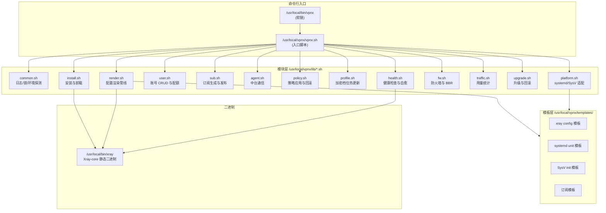
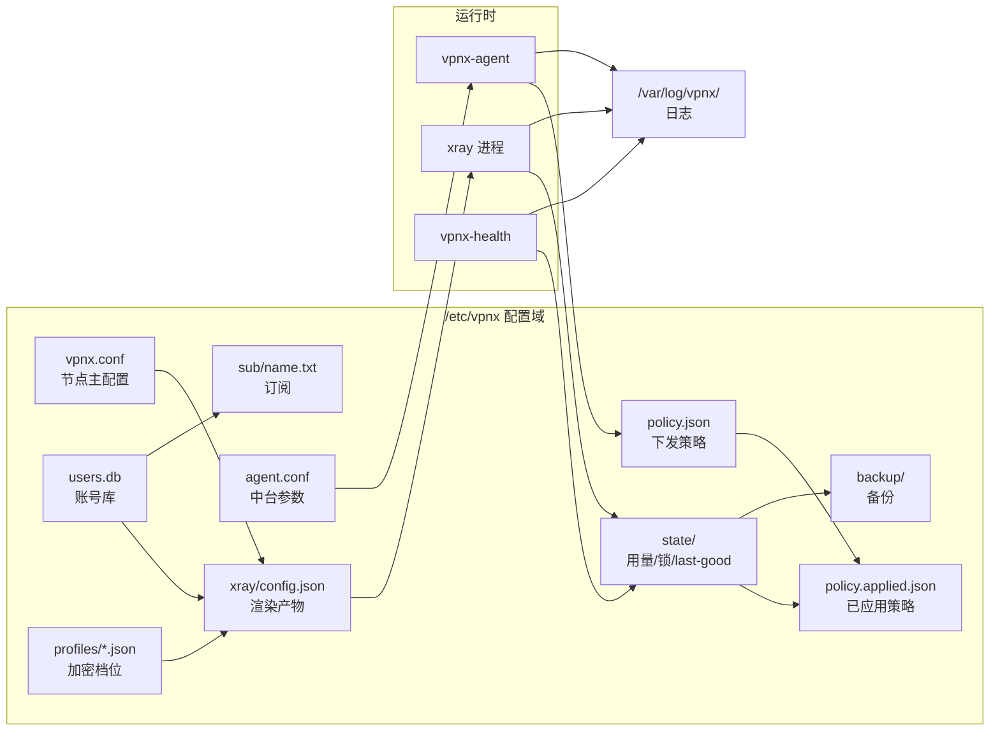
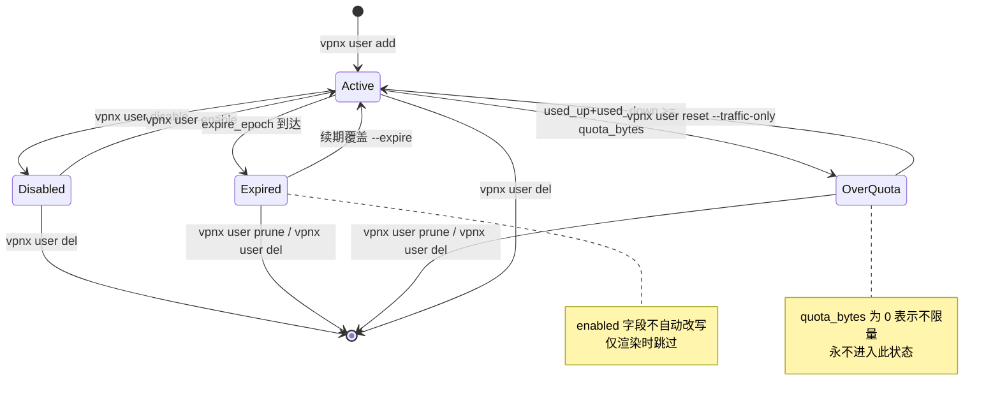
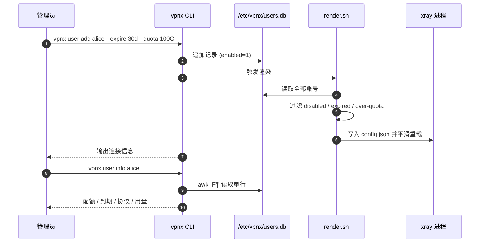
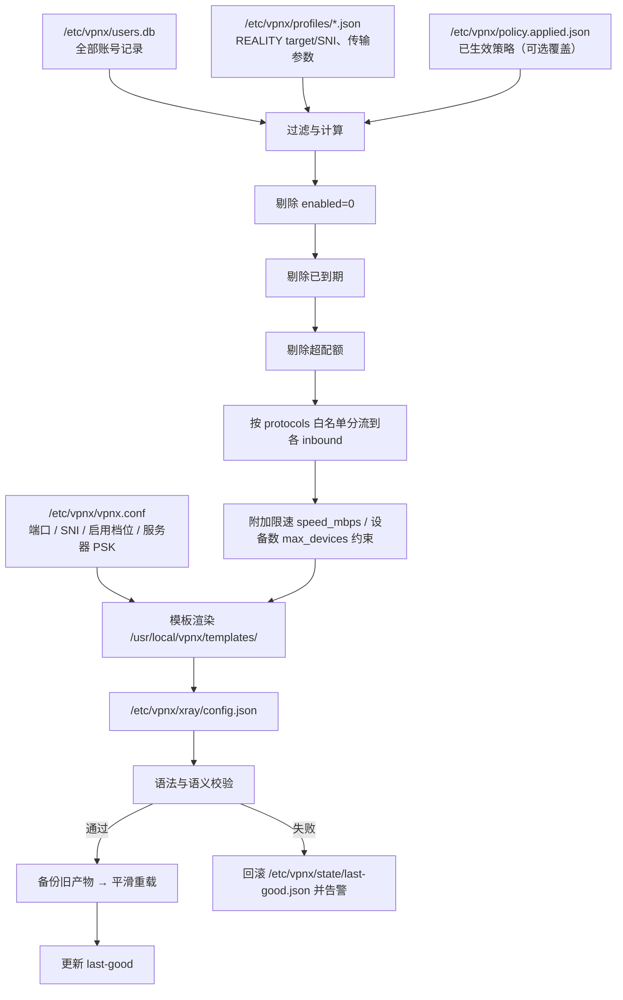
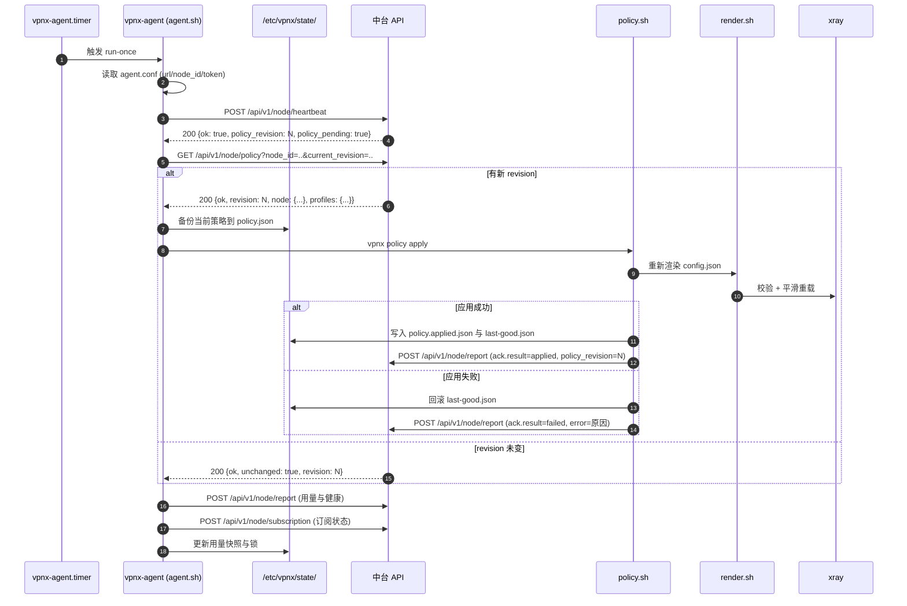
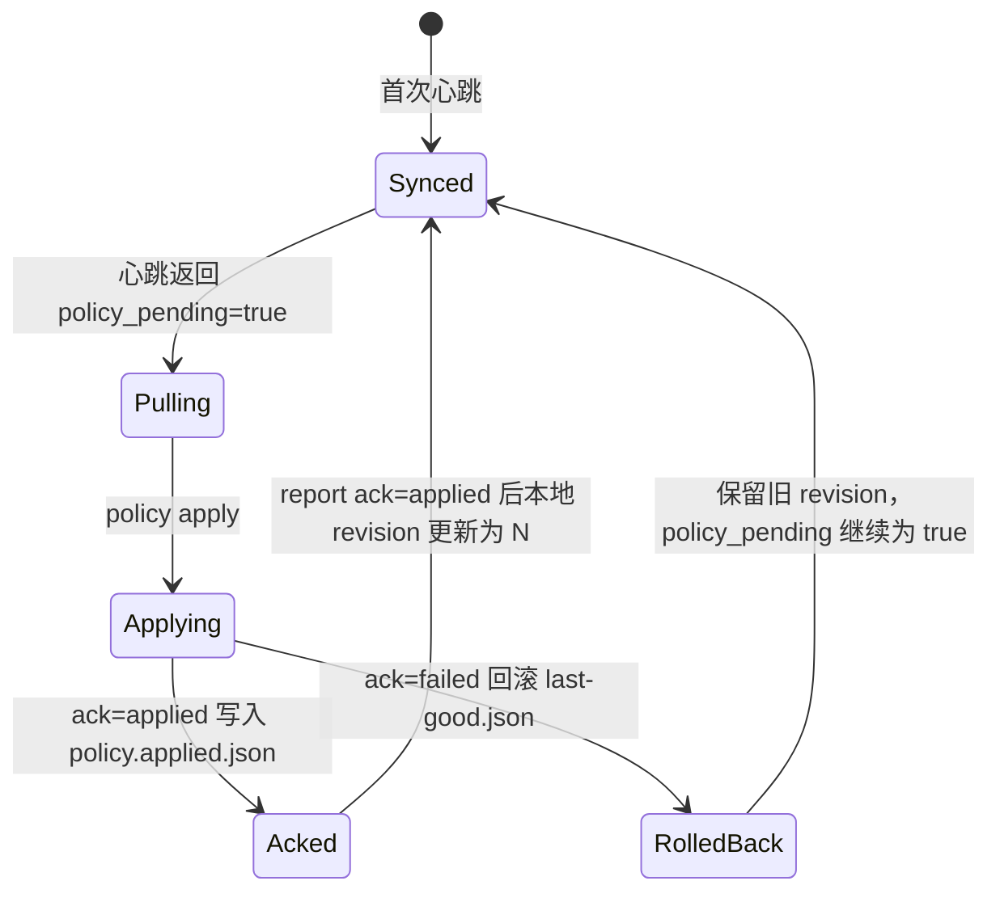
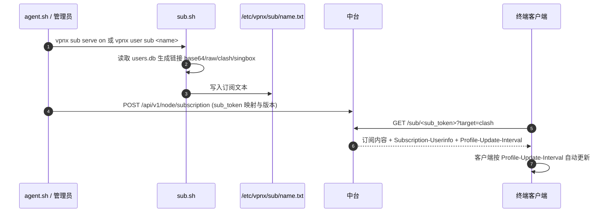

# vpnx 总体架构

> 本文描述 **vpnx** 的设计结构与内部数据流。vpnx 的目标是：在海外 VPS 上以「零依赖、可脚本化、可中台纳管」的方式自动部署 Xray-core 代理/VPN 节点，并提供多账号管理与中台同步能力。
>
> 本文只描述**已实现的第一阶段**（部署脚本 + 账号逻辑）与**已确定的接口契约**。文中未列出的命令、路径、字段一律不作为契约；所有子命令的具体参数以节点上的 `vpnx <cmd> --help` 为准。

---

## 1. 设计目标与约束

| 目标 | 具体约束 | 设计后果 |
| --- | --- | --- |
| 单机可跑、零依赖 | 不装 Nginx / PHP / 数据库；除 shell 工具链外不引入运行时 | 引擎选型为单个静态二进制 Xray-core（约 20MB） |
| 不需要域名与证书 | 无法要求用户准备域名，也避免证书续期失败 | 主协议用 VLESS + REALITY + XTLS Vision，借用真实站点 TLS 指纹 |
| 与 建站面板共存 | 面板可能自带 nginx/apache/mysql/php 并占用 80/443 | REALITY 不监听 80/443，端口从候选池挑未占用高位端口 |
| 老机器可运行 | CentOS 7、glibc 2.17、无 systemd 的环境仍需支持 | 账号库用 `|` 分隔文本；无 systemd 走 SysV + cron 降级 |
| 可被中台纳管 | 需要心跳、策略下发、用量上报、订阅发布 | 自带 agent + 签名请求 + revision/ack 机制 |
| 可热更新 | 不因换档位/换 SNI 而中断全部在线连接 | 配置渲染管线 + 加密档位（profiles）+ last-good 回滚 |

### 1.1 为什么选 Xray-core + REALITY

1. **单静态二进制、几乎无依赖**：Xray-core 是一个约 20MB 的静态链接二进制，放到 `/usr/local/bin/xray` 即可运行。不需要 Nginx、PHP、MySQL，不需要编译工具链，也不需要额外的系统库。部署脚本在网络受限的 VPS 上只需要下载一个文件。
2. **不需要域名与证书**：REALITY 借用真实站点的 TLS 握手特征（真实站点的证书链与指纹在握手阶段被"借"过来），因此**无需自己持有域名、无需申请/续期证书**。这直接消灭了部署中最常见的两个失败点：DNS 未生效、ACME 签发失败。
3. **不占用 80/443**：REALITY 可以监听任意高位端口，天然适合与面板自带的 Web 服务并存。建站面板 的 nginx/apache 继续占用 80/443，互不干扰。
4. **XTLS Vision 抗特征**：`xtls-rprx-vision` 消除了 TLS-in-TLS 的典型长度特征，配合 REALITY 的真实站点指纹，在中度封锁环境下表现稳定。
5. **多协议共存**：同一份 Xray 配置里可以同时开 VLESS+REALITY、Shadowsocks 2022、VMess+WebSocket，按入站（inbound）划分，账号按协议授权，兼容新老客户端。

### 1.2 为什么账号库用文本记录而不是 JSON

`/etc/vpnx/users.db` 采用 `|` 分隔的纯文本记录，而不是 JSON，原因是最现实的工程约束：

| 维度 | `|` 分隔文本 | JSON |
| --- | --- | --- |
| 极老机器的解析依赖 | `awk` / `sed` / `cut` / `grep` 全部自带 | 需要 jq 或 python 才能可靠解析 |
| CentOS 6 / glibc 2.17 环境 | 可用 | 常常需要额外装包，离线环境易失败 |
| Shell 内单行读写 | `awk -F'|' '$1==name'` 直接完成 | 需要引号/转义处理，shell 里易出错 |
| 人工排查 | `cat` 即可读，`grep <name>` 即可定位 | 长行、嵌套结构，肉眼难读 |
| 与 `format=lines` 简化协议一致性 | 一致，同一套解析习惯 | 不一致，需要两套解析逻辑 |
| 主要风险 | 字段含 `|` 需约束（`note` 不得含 `|`） | 结构安全但工具链重 |

因此：**字段顺序固定、以 `|` 分隔、行内不允许出现 `|`**（`note` 写入前做过滤）。作为代价，`users.db` 不做嵌套结构；超出扁平字段的元数据通过附加文件（如 `/etc/vpnx/profiles/*.json`）承载。

---

## 2. 节点内部模块结构

节点侧代码位于 `/usr/local/vpnx/`：入口为 `vpnx.sh`，业务逻辑拆到 `lib/*.sh`，配置模板放在 `templates/`。



### 2.1 模块职责速查

| 模块 | 职责 | 主要产出 |
| --- | --- | --- |
| `common.sh` | 日志、锁、路径常量、发行版/内核/架构探测、`--debug` 输出 | 供其他模块 `source` 的基础函数 |
| `install.sh` | 依赖探测、二进制下载与校验、端口挑选、目录初始化、服务注册 | `/usr/local/bin/xray`、`/etc/vpnx/*`、服务单元 |
| `render.sh` | 由 `vpnx.conf` + `users.db` + `profiles/*.json` 渲染 `xray/config.json` | `/etc/vpnx/xray/config.json` |
| `user.sh` | 账号增删改查、配额与限速、到期判定、批量清理 | `/etc/vpnx/users.db` |
| `sub.sh` | 订阅文本生成（base64/raw/clash/singbox）、订阅发布开关 | `/etc/vpnx/sub/<name>.txt` |
| `agent.sh` | 心跳、策略拉取、用量上报、订阅上报、脚本更新 | `/etc/vpnx/agent.conf`、服务与 timer |
| `policy.sh` | 解析、校验、应用、ack/回滚中台策略 | `/etc/vpnx/policy.json`、`policy.applied.json`、`state/last-good.json` |
| `profile.sh` | 加密与传输档位热更新，支持签名档位包 | `/etc/vpnx/profiles/*.json` |
| `health.sh` | 端口/进程/握手/时间/磁盘检查与自动修复 | `/var/log/vpnx/`、`state/` |
| `fw.sh` | 三路防火墙适配（firewalld/ufw/iptables）、BBR 开关 | 自建链、自建 ufw 规则 |
| `traffic.sh` | 采集上下行用量、写入 `used_up`/`used_down` | `users.db`、`state/` |
| `upgrade.sh` | 二进制与脚本升级、失败回滚 | `/etc/vpnx/backup/` |
| `platform.sh` | systemd 与 SysV 双路径适配、timer 与 cron.d 二选一 | 服务单元 / init 脚本 |

---

## 3. 文件系统布局与数据流



### 3.1 路径清单（契约）

| 路径 | 类型 | 说明 |
| --- | --- | --- |
| `/usr/local/vpnx/vpnx.sh` | 文件 | CLI 入口脚本 |
| `/usr/local/vpnx/lib/*.sh` | 目录 | 模块实现 |
| `/usr/local/vpnx/templates/` | 目录 | 配置与服务模板 |
| `/usr/local/bin/xray` | 文件 | Xray-core 二进制 |
| `/usr/local/bin/vpnx` | 软链 | 指向 `/usr/local/vpnx/vpnx.sh` |
| `/etc/vpnx/vpnx.conf` | 文件 | 节点主配置（端口、SNI、启用档位等） |
| `/etc/vpnx/xray/config.json` | 文件 | 渲染产物，Xray 实际读取 |
| `/etc/vpnx/users.db` | 文件 | 账号库，`|` 分隔文本记录 |
| `/etc/vpnx/agent.conf` | 文件 | 中台 URL / node_id / token |
| `/etc/vpnx/policy.json` | 文件 | 中台下发策略原文 |
| `/etc/vpnx/policy.applied.json` | 文件 | 最近一次成功应用的策略 |
| `/etc/vpnx/sub/<name>.txt` | 文件 | 按账号生成的订阅文本 |
| `/etc/vpnx/profiles/*.json` | 目录 | 加密与传输档位 |
| `/etc/vpnx/state/` | 目录 | 用量、锁、`last-good.json` |
| `/etc/vpnx/backup/` | 目录 | 升级/变更前备份 |
| `/var/log/vpnx/` | 目录 | 全部 vpnx 日志（**不写面板日志目录**） |

### 3.2 服务单元

| 平台 | 单元 | 作用 |
| --- | --- | --- |
| systemd | `xray.service` | 常驻代理引擎 |
| systemd | `vpnx-agent.service` + `vpnx-agent.timer` | 中台同步（定时触发 run-once） |
| systemd | `vpnx-health.service` + `vpnx-health.timer` | 健康巡检与自愈 |
| SysV | `/etc/init.d/xray` | 无 systemd 环境的代理引擎 |
| SysV | `/etc/init.d/vpnx-agent` | 无 systemd 环境的中台同步 |
| cron 降级 | `/etc/cron.d/vpnx-*` | 无 systemd 时替代 timer，**不使用面板的 crontab** |

---

## 4. 账号库数据模型

### 4.1 记录格式

`/etc/vpnx/users.db` 每行一条账号记录，字段以 `|` 分隔，**顺序固定**：

```
name|uuid|enabled|expire_epoch|quota_bytes|used_up|used_down|speed_mbps|max_devices|protocols(csv)|ss_user_psk|sub_token|created_epoch|note
```

| # | 字段 | 类型 | 说明 |
| --- | --- | --- | --- |
| 1 | `name` | string | 账号名，唯一键；建议 `[a-z0-9_-]` |
| 2 | `uuid` | string | VLESS / VMess 使用的 UUID |
| 3 | `enabled` | 0/1 | 是否启用；`0` 时该账号不进入渲染产物 |
| 4 | `expire_epoch` | int | 到期时间（Unix 秒）；`0` 表示永不过期 |
| 5 | `quota_bytes` | int | 总配额（字节）；`0` 表示不限量 |
| 6 | `used_up` | int | 已用上行（字节） |
| 7 | `used_down` | int | 已用下行（字节） |
| 8 | `speed_mbps` | int | 限速（Mbps）；`0` 表示不限速 |
| 9 | `max_devices` | int | 最大设备数；`0` 表示不限制 |
| 10 | `protocols` | csv | 该账号可用的协议集合，如 `reality,ss2022` |
| 11 | `ss_user_psk` | string | Shadowsocks 2022 用户级 PSK（多用户模式） |
| 12 | `sub_token` | string | 订阅令牌，对应 `GET /sub/<sub_token>` |
| 13 | `created_epoch` | int | 创建时间（Unix 秒） |
| 14 | `note` | string | 备注；**不得包含 `|`** |

> Shadowsocks 2022 使用 `2022-blake3-aes-128-gcm` 与多用户模式；客户端填写的密码为 `服务器PSK:用户PSK`，其中服务器 PSK 来自节点主配置 `/etc/vpnx/vpnx.conf`，用户 PSK 即 `ss_user_psk`。

### 4.2 协议与账号字段的关系

| 协议标识 | 引擎入站 | 依赖账号字段 | 客户端示例 |
| --- | --- | --- | --- |
| `reality`（主） | VLESS + REALITY + `xtls-rprx-vision` | `uuid` | Shadowrocket、v2rayN/NG、Clash Meta/Mihomo、sing-box、Stash |
| `ss2022`（备） | Shadowsocks 2022，`2022-blake3-aes-128-gcm`，多用户 | `ss_user_psk`（配合服务器 PSK） | sing-box、Mihomo、Shadowrocket |
| `vmess-ws`（兼容） | VMess + WebSocket | `uuid` | 老版 v2rayN/NG 及老客户端 |
| `xhttp`（新传输） | VLESS + XHTTP + REALITY（复用 REALITY 密钥；**flow 必须为空**） | `uuid` | 支持 XHTTP 的新客户端；**不进默认 clash 订阅**，走 `/clash-xhttp` 独立链接 |

`protocols` 字段是**授权白名单**：渲染时只为该账号生成其授权协议所需的用户条目。

---

## 5. 账号生命周期状态机

账号有四个可观测状态：**未创建 → 启用（active）→ 停用（disabled）/ 过期（expired）/ 超配额（over-quota）→ 回收（deleted）**。



### 5.1 状态判定与生效层次

判定来源有两层，必须区分：

| 层 | 位置 | 生效方式 |
| --- | --- | --- |
| 持久状态 | `users.db` 的 `enabled` / `expire_epoch` / `quota_bytes` / `used_*` | 由 `vpnx user *` 子命令写入 |
| 运行态 | `/etc/vpnx/xray/config.json` 中的用户条目 | 由渲染管线从 `users.db` 重新计算 |

- **显式停用**：`vpnx user disable <name>` 把 `enabled` 置 `0`，渲染时该账号不出现。
- **过期**：`expire_epoch` 到达后，渲染管线按"到期"规则跳过该账号；`enabled` 本身不改写，便于续期后立即复活。
- **超配额**：`quota_bytes > 0` 且 `used_up + used_down >= quota_bytes` 时视为超配额，渲染时跳过；`vpnx user reset <name> --traffic-only` 清零用量后恢复。
- **回收**：`vpnx user del <name>` 删除单条记录；`vpnx user prune` 批量清理到期/超配额账号。

### 5.2 一次账号变更的完整时序



---

## 6. 配置渲染管线

`/etc/vpnx/xray/config.json` **不是手写文件**，而是每次变更后由渲染管线重新生成的产物。这条管线是 vpnx 一致性的核心：所有状态都在 `users.db` / `vpnx.conf` / `profiles/*.json`，产物随时可重建。



### 6.1 渲染触发点

| 触发 | 命令 | 说明 |
| --- | --- | --- |
| 首次安装 | `vpnx install` | 端到端生成配置并启动服务 |
| 账号变更 | `vpnx user add` / `del` / `enable` / `disable` / `reset` / `prune` | 变更后重新渲染 |
| 策略应用 | `vpnx policy apply <file\|->`、`vpnx policy pull` | 策略生效后重建配置 |
| 档位更新 | `vpnx profile add <file>` | 新档位落地后重建配置 |
| 手动修复 | `vpnx health fix`、`vpnx doctor` | 检测到配置漂移时重建 |

### 6.2 平滑重载与回滚

1. 渲染前，若当前配置已确认可用，则把当前 `config.json` 快照写入 `/etc/vpnx/state/last-good.json`。
2. 渲染后执行语法与语义校验；失败则丢弃新产物，恢复 `last-good.json`，并记录到 `/var/log/vpnx/`。
3. 校验通过后备份到 `/etc/vpnx/backup/`，再触发引擎重载。

> 演练类操作推荐使用全局参数 `--dry-run`（只渲染不落地）。具体渲染行为以 `vpnx install --help`、`vpnx policy apply --help` 为准。

---

## 7. 中台交互时序

节点与中台之间是**节点主动外联**的单向发起模型：节点不向中台暴露管理入站端口，中台也不主动连接节点。

### 7.1 接口一览

| 方向 | 方法 | 路径 | 用途 |
| --- | --- | --- | --- |
| 节点 → 中台 | `POST` | `/api/v1/node/heartbeat` | 上报存活、版本、端口、负载摘要 |
| 节点 → 中台 | `GET` | `/api/v1/node/policy?current_revision=N` | 拉取策略（无变化时返回 `unchanged`） |
| 节点 → 中台 | `POST` | `/api/v1/node/report` | 上报账号用量、聚合流量、健康结果 |
| 节点 → 中台 | `POST` | `/api/v1/node/subscription` | 发布订阅条目（账号、令牌、分享链接） |
| 节点 → 中台 | `POST` | `/api/v1/node/script/update` | 查询脚本更新（上报版本，返回下载地址与校验值） |
| 客户端 → 中台 | `GET` | `/sub/<sub_token>?target=base64\|raw\|clash\|singbox` | 终端用户订阅下载 |

完整字段表、错误码与签名示例见 [`CENTRAL-API.md`](./CENTRAL-API.md)。

### 7.2 一次同步周期



### 7.3 鉴权与防重放

所有「节点 → 中台」请求携带四个头：

| 请求头 | 说明 |
| --- | --- |
| `X-VPNX-Node` | 节点 ID（`node_id`），与 `agent.conf` 一致 |
| `X-VPNX-Timestamp` | Unix 秒级时间戳 |
| `X-VPNX-Nonce` | 一次性随机串 |
| `X-VPNX-Signature` | 见下方算法 |

```
HMAC_SHA256(secret, METHOD\nPATH\nTIMESTAMP\nNONCE\nSHA256_HEX(body))
```

- 时间窗：**300 秒**，超出即拒绝。
- `nonce` 在同一时间窗内**不得重复**（中台侧缓存去重）。
- `SHA256_HEX(body)` 为请求体的 SHA-256 十六进制小写摘要；无请求体时对空字符串求哈希。

### 7.4 revision 与 ack



- `revision` **单调递增**，节点只接受比本地更大的 revision。
- 应用结果必须回报 ack：`applied` 或 `failed`。
- 失败时回滚到 `/etc/vpnx/state/last-good.json`，保证节点不会因一条坏策略离线。
- 无 `jq`/`python` 的极老机器：中台可对 `GET /api/v1/node/policy` 与 `POST /api/v1/node/report` 返回 `?format=lines`，以 `key=value` 逐行格式替代 JSON（订阅接口不适用该参数，详见 [`CENTRAL-API.md`](./CENTRAL-API.md#9-formatlines-简化协议)）。

### 7.5 订阅发布流程



### 7.6 中台不可用时的降级

| 场景 | 行为 |
| --- | --- |
| 心跳失败 | 本地继续服务，记录日志，下个 timer 周期重试 |
| 策略拉取失败 | 沿用 `policy.applied.json`，不改变现网配置 |
| 上报失败 | 用量先落 `/etc/vpnx/state/`，恢复后补报 |
| 中台返回非法策略 | `vpnx policy apply` 校验失败 → ack `failed` → 回滚 |
| 使用 `--offline` 全局参数 | 使用本地缓存包、不联网；适用于隔离网络内的重装/修复 |

---

## 8. 关键设计取舍汇总

| 决策 | 选择 | 放弃 | 理由 |
| --- | --- | --- | --- |
| 引擎 | Xray-core 单静态二进制 | 自编译、多文件部署 | VPS 上近乎零依赖，单文件校验即可 |
| 主协议 | VLESS + REALITY + XTLS Vision | VMess + TLS + 自持证书 | 不需要域名与证书，抗探测更好 |
| 备用协议 | Shadowsocks 2022（多用户）、VMess + WebSocket | 只保留单一协议 | 兼容新老客户端，切换成本低 |
| 账号库 | `|` 分隔文本 | JSON / SQLite | 老机器无 jq/python，无需额外运行时 |
| 配置 | 模板渲染产物，禁止手改 | 手写 `config.json` | 状态单一来源，可重建、可回滚 |
| 端口 | 候选池自动挑未占用高位端口 | 固定 443 | 避开面板占用与常见扫描/封禁面 |
| 定时 | systemd timer | 面板 crontab | 与 建站面板 解耦，不污染面板任务 |
| 防火墙 | 自建链 / 自建 ufw 规则 | `iptables -F` | 绝不破坏面板已有规则 |
| 回滚 | `/etc/vpnx/state/last-good.json` | 现场人工修 | 坏策略不会导致节点失联 |
| 中台通信 | 节点主动外联 + HMAC 签名 | 中台被动连节点 | 节点无需暴露管理端口 |

---

## 9. 与其他文档的关系

| 文档 | 内容 |
| --- | --- |
| [`COMPATIBILITY.md`](./COMPATIBILITY.md) | 发行版/架构/内核矩阵、依赖探测与降级、建站面板 共存清单 |
| [`OPERATIONS.md`](./OPERATIONS.md) | 首次部署、命令速查、故障排查、备份恢复、升级回滚 |
| [`CENTRAL-API.md`](./CENTRAL-API.md) | 中台接口契约、签名示例、revision/ack、订阅发布、`format=lines` |
| [`ROADMAP.md`](./ROADMAP.md) | 后续阶段的档位热更新、抗封锁、多节点、计费等规划 |

> 通用约定：本文出现的命令与参数均为已确定契约；子命令的**实现细节以 `vpnx <cmd> --help` 为准**。