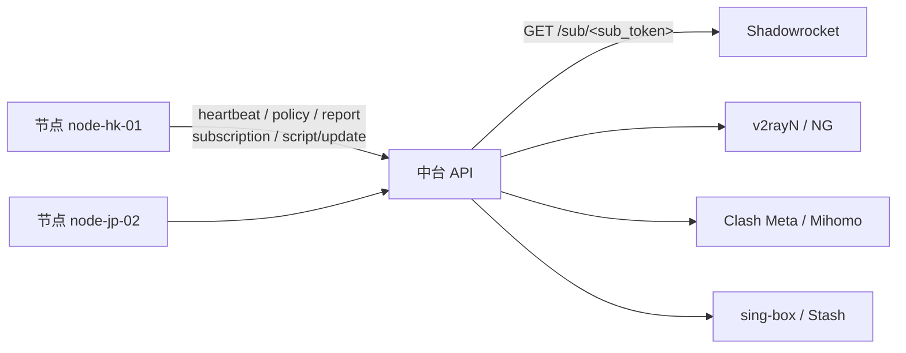
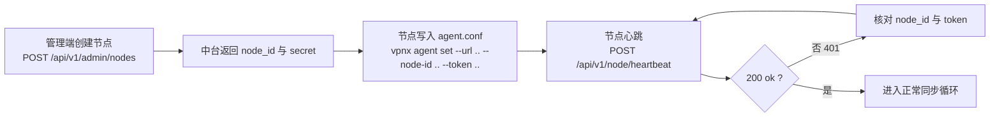
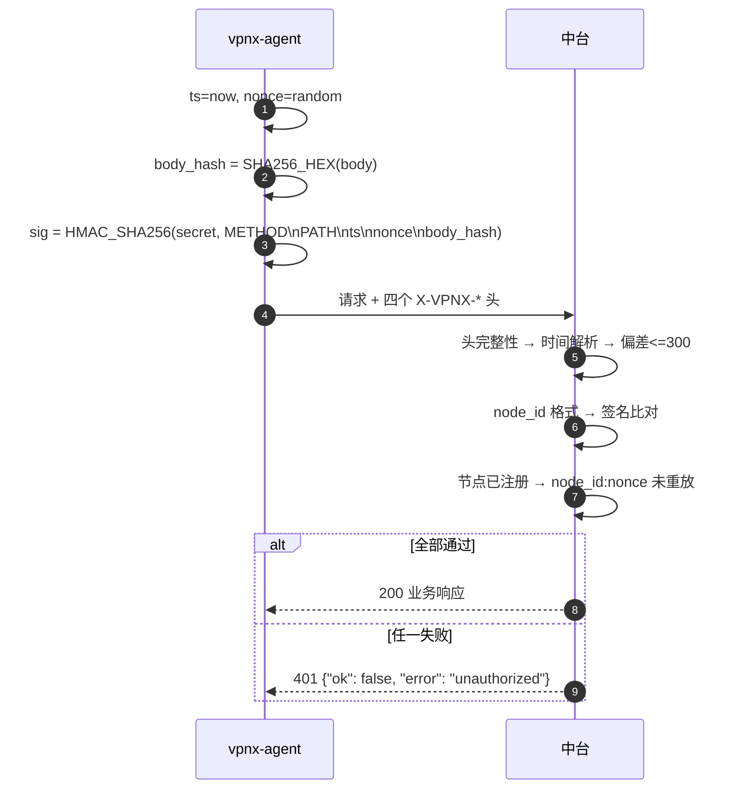
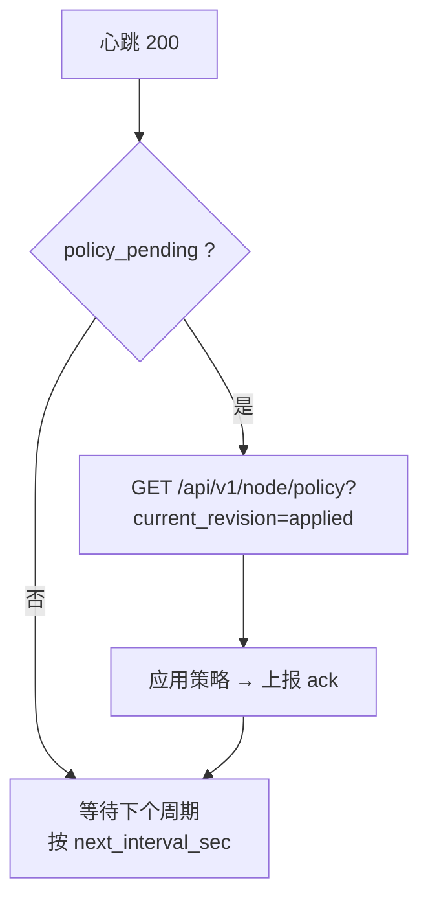
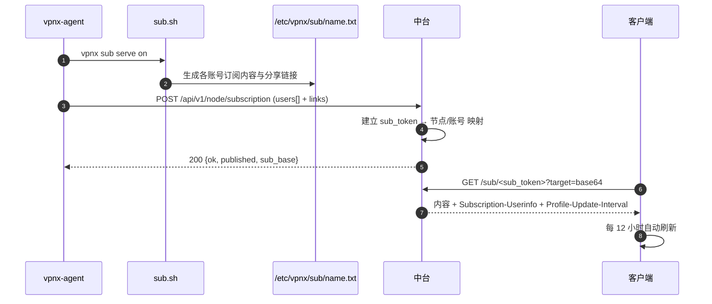
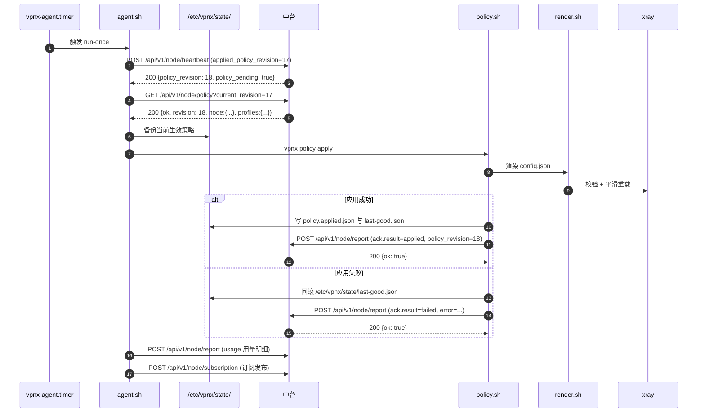
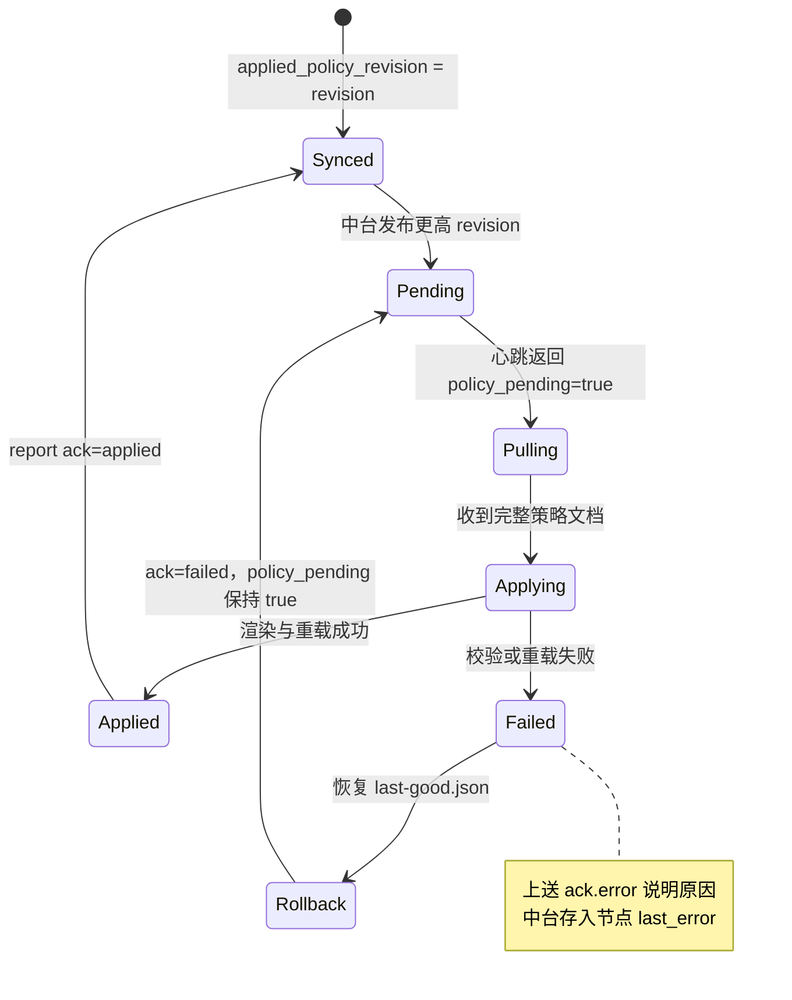
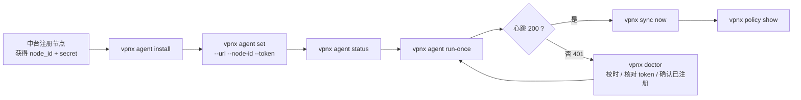

# vpnx 中台接口契约

> 本文定义 **vpnx 节点**与**中台**之间的完整接口契约，以及面向终端客户端的订阅接口。
>
> 所有路径、请求头、字段名均为契约的一部分。本文以中台实现的实际线格式为准：
> 线上部署的是 PHP 版 [`central/api.php`](../central/api.php)（PHP + JSON，无数据库），
> 同一契约还有一份 Python 标准库参考实现 [`references/central-python/server.py`](../references/central-python/server.py)
> 可作差分对照；节点侧命令的**实现细节以 `vpnx <cmd> --help` 为准**。

---

## 1. 总览

| 方向 | 方法 | 路径 | 用途 | 鉴权 |
| --- | --- | --- | --- | --- |
| 节点 → 中台 | `POST` | `/api/v1/node/heartbeat` | 心跳与状态上报 | HMAC 签名 |
| 节点 → 中台 | `GET` | `/api/v1/node/policy?current_revision=N` | 拉取策略 | HMAC 签名 |
| 节点 → 中台 | `POST` | `/api/v1/node/report` | 用量 / 事件 / ack 上报 | HMAC 签名 |
| 节点 → 中台 | `POST` | `/api/v1/node/subscription` | 发布订阅内容 | HMAC 签名 |
| 节点 → 中台 | `POST` | `/api/v1/node/script/update` | 脚本自更新查询 | HMAC 签名 |
| 客户端 → 中台 | `GET` | `/sub/<sub_token>?target=base64\|raw\|clash\|singbox` | 终端用户订阅下载 | 凭 `sub_token` |
| 管理端 → 中台 | `*` | `/api/v1/admin/*` | 节点注册、策略下发、用量查询 | 管理员 token |

**模型特征**：节点**主动外联**中台，中台不主动连接节点；节点无需向中台暴露管理端口。所有「节点 → 中台」请求必须签名。



### 1.1 通用约定

| 项 | 约定 |
| --- | --- |
| 基础地址 | 由 `/etc/vpnx/agent.conf` 中的 `url` 指定 |
| 版本前缀 | `/api/v1/` |
| 请求体 | `application/json; charset=utf-8` |
| 响应体 | `application/json; charset=utf-8`（`format=lines` 时为 `text/plain`） |
| 时间 | Unix 秒级时间戳（UTC） |
| 时钟偏差上限 | **300 秒**（`NONCE_WINDOW_SEC`） |
| nonce 作用域 | `node_id:nonce`，即不同节点可用相同 nonce |
| 节点在线判定 | 最近心跳在 **180 秒**内 |
| 字符编码 | UTF-8 |

### 1.2 前置条件：节点必须先注册

**重要**：节点不是自注册的。中台收到未注册 `node_id` 的请求时**统一返回 `401 unauthorized`**（不区分"节点不存在"与"签名错误"，以避免节点枚举）。

因此接入顺序必须是：



---

## 2. 鉴权与签名

### 2.1 请求头

所有「节点 → 中台」请求必须携带：

| 请求头 | 必填 | 说明 | 示例 |
| --- | --- | --- | --- |
| `X-VPNX-Node` | 是 | 节点 ID，需满足 `^[A-Za-z0-9][A-Za-z0-9_.-]{0,63}$` | `node-hk-01` |
| `X-VPNX-Timestamp` | 是 | Unix 秒级时间戳 | `1767225600` |
| `X-VPNX-Nonce` | 是 | 一次性随机串（建议 16–32 字节随机十六进制） | `9f2c41ab77d0e5c3` |
| `X-VPNX-Signature` | 是 | HMAC-SHA256 签名，十六进制（按小写比较） | `c1a9...e7` |
| `Content-Type` | 有请求体时 | `application/json; charset=utf-8` | — |

### 2.2 签名算法

```
HMAC_SHA256(secret, METHOD\nPATH\nTIMESTAMP\nNONCE\nSHA256_HEX(body))
```

| 组成 | 说明 |
| --- | --- |
| `secret` | 节点密钥，来自中台签发（节点不存在时中台用 64 个 `0` 占位计算，以保持响应一致） |
| `METHOD` | HTTP 方法转**大写**，如 `POST`、`GET` |
| `PATH` | 请求路径，**已剥离 query string**（请求 `/api/v1/node/policy?current_revision=17` 时签 `/api/v1/node/policy`），见 §2.5 |
| `TIMESTAMP` | 与 `X-VPNX-Timestamp` 完全一致，以字符串形式参与拼接 |
| `NONCE` | 与 `X-VPNX-Nonce` 完全一致 |
| `SHA256_HEX(body)` | 请求体 SHA-256 十六进制**小写**；无请求体时对空字节串求哈希 |
| 分隔符 | 字面 `\n`（LF，`0x0A`），共 4 个换行 |

参考实现等价代码：

```python
body_hash = hashlib.sha256(body or b"").hexdigest()
message = "\n".join([method.upper(), path, str(timestamp), nonce, body_hash])
signature = hmac.new(secret.encode("utf-8"), message.encode("utf-8"),
                     hashlib.sha256).hexdigest()
```

签名串逐行示例（`\n` 为真实换行）：

```
POST\n/api/v1/node/heartbeat\n1767225600\n9f2c41ab77d0e5c3\ne3b0c44298fc1c149afbf4c8996fb92427ae41e4649b934ca495991b7852b855
```

### 2.3 校验顺序与失败响应

中台按以下顺序校验，任一失败都返回同一个响应体：

| 顺序 | 校验项 | 失败结果 |
| --- | --- | --- |
| 1 | 四个 `X-VPNX-*` 头均非空 | `401` + `{"ok": false, "error": "unauthorized"}` |
| 2 | `X-VPNX-Timestamp` 可解析为整数 | 同上 |
| 3 | `abs(now - timestamp) <= 300` | 同上 |
| 4 | `node_id` 格式合法 | 同上 |
| 5 | 签名匹配（常量时间比较） | 同上 |
| 6 | `node_id` 已注册 | 同上 |
| 7 | `node_id:nonce` 未在时间窗内使用过 | 同上 |

> 失败响应**刻意不区分原因**，这是安全设计：攻击者无法通过错误信息枚举节点是否存在。



### 2.4 nonce 防重放

| 规则 | 实现 |
| --- | --- |
| 缓存键 | `node_id:nonce` |
| 窗口 | 300 秒（与时钟偏差窗口一致） |
| 重复提交 | 判定为鉴权失败，返回 `401 unauthorized` |
| 多副本 | 见 [`ROADMAP.md`](./ROADMAP.md)：高可用阶段需将 nonce 缓存跨副本共享 |

### 2.5 `PATH` 必须剥离 query string

中台的路由层（PHP 版在 `central/api.php`，参考实现 `server.py`）先把请求行拆成
`path`（`unquote(parsed.path)`）与 `query`，
再用**不含 query 的 `path`** 调用 `verify_node_request`；中台自带的 24 个测试同样按
`path.split("?")[0]` 构造签名。节点必须与此完全一致：

| 请求行 | 参与签名的 `PATH` |
| --- | --- |
| `POST /api/v1/node/heartbeat` | `/api/v1/node/heartbeat` |
| `GET /api/v1/node/policy?node_id=n1&current_revision=17` | `/api/v1/node/policy` |

> **实现要点**：请求 URL 照常带 query，但签名只覆盖 query 之前的部分。
> `vpnx` 的 `agent_request()` 已按此实现（`path="${fullpath%%\?*}"`）。
> 若出现 `401 unauthorized` 且 token 正确，优先排查此处差异与时钟偏差，
> 可用 `vpnx agent run-once --debug` 观察实际签名串。

---

## 3. 通用响应结构

### 3.1 成功响应

节点接口的成功响应为**扁平 JSON**，以 `ok: true` 标识成功：

```json
{
  "ok": true,
  "server_time": 1767225600,
  "policy_revision": 18,
  "policy_pending": true,
  "next_interval_sec": 300
}
```

### 3.2 错误响应

```json
{
  "ok": false,
  "error": "unauthorized"
}
```

| 字段 | 类型 | 说明 |
| --- | --- | --- |
| `ok` | bool | `true` 成功，`false` 失败 |
| `error` | string | 失败原因（**无独立错误码常量**，见下表） |

### 3.3 状态码与 `error` 取值表

| HTTP | `error` 取值 | 含义 | 节点侧处置 |
| --- | --- | --- | --- |
| `400` | `body must be a json object` | 请求体不是 JSON 对象 | 检查请求组装 |
| `400` | `bad path` | 路径非法 | 核对接口路径 |
| `401` | `unauthorized` | 头缺失 / 时间超窗 / 签名错误 / 节点未注册 / nonce 重放 | 见 §2.3 逐项排查，优先核对 token 与时钟 |
| `404` | `not found` | 路径不存在或 `sub_token` 不存在 | 核对路径；订阅令牌是否已发布 |
| `405` | `method not allowed` | 方法不匹配 | 使用契约规定的方法 |
| `409` | `node already exists: <node_id>` | 管理端重复创建节点 | 换 ID 或改用轮换接口 |
| `500` | `internal error` | 中台内部错误 | 退避重试；持续失败则告警 |

> 说明：中台对「节点鉴权失败」统一使用 `401 unauthorized`，不返回细分原因。历史上的细分错误码（如 `E_SIGNATURE_INVALID`）**不是当前实现的契约**。

### 3.4 重试与退避

| 情形 | 节点行为 |
| --- | --- |
| `401 unauthorized` | 记录日志并告警；**不要高频重试**（避免持续失败刷日志），等待人工核对 |
| `5xx` / `500` | 指数退避重试 |
| 网络超时 | 退避重试，本地代理服务不受影响 |
| 心跳响应中的 `next_interval_sec` | 作为下次唤醒间隔的参考值 |
---

## 4. 接口详细契约

### 4.1 `POST /api/v1/node/heartbeat`

**用途**：上报节点存活与状态；中台据此更新节点记录并返回策略 revision 与**是否存在待应用策略**。

**请求体**（仅下列字段会被中台接收；其余字段忽略）

| 字段 | 类型 | 必填 | 说明 |
| --- | --- | --- | --- |
| `hostname` | string | 否 | 节点主机名 |
| `agent_version` | string | 否 | vpnx agent/脚本版本 |
| `xray_version` | string | 否 | Xray-core 版本 |
| `os` | string | 否 | 发行版标识，如 `ubuntu-22.04` |
| `kernel` | string | 否 | 内核版本，如 `5.15.0-91-generic` |
| `arch` | string | 否 | 架构，`x86_64` / `aarch64` / `armv7` |
| `public_ip` | string | 否 | 节点公网 IP |
| `uptime_sec` | int | 否 | 运行时长（秒） |
| `load1` | number | 否 | 1 分钟负载 |
| `mem_used_pct` | number | 否 | 内存使用率（%） |
| `disk_used_pct` | number | 否 | 磁盘使用率（%） |
| `inbounds` | array | 否 | 入站摘要列表 |
| `users_total` | int | 否 | 账号总数 |
| `users_active` | int | 否 | 生效账号数 |
| `traffic_total_bytes` | int | 否 | 累计流量（字节） |
| `health` | string | 否 | 自检结论，如 `ok` / `warn` / `fail` |
| `applied_policy_revision` | int | 否 | 节点本地**已应用**的策略 revision |

**请求示例**

```json
{
  "hostname": "hk-01",
  "agent_version": "v1.0.0",
  "xray_version": "vX.Y.Z",
  "os": "ubuntu-22.04",
  "kernel": "5.15.0-91-generic",
  "arch": "x86_64",
  "public_ip": "1.2.3.4",
  "uptime_sec": 86400,
  "load1": 0.12,
  "mem_used_pct": 31.2,
  "disk_used_pct": 44.0,
  "inbounds": [{ "tag": "vless-reality", "port": 8443, "protocol": "vless" }],
  "users_total": 42,
  "users_active": 39,
  "traffic_total_bytes": 24696061952,
  "health": "ok",
  "applied_policy_revision": 17
}
```

**响应体**

| 字段 | 类型 | 说明 |
| --- | --- | --- |
| `ok` | bool | `true` |
| `server_time` | int | 中台当前 Unix 秒（可用于校正本地时钟偏差） |
| `policy_revision` | int | 中台当前策略 revision |
| `policy_pending` | bool | 是否有待应用策略：节点 `applied_policy_revision < revision`，或上次 ack 结果为 `failed` |
| `next_interval_sec` | int | 建议下次心跳间隔（秒） |

```json
{
  "ok": true,
  "server_time": 1767225600,
  "policy_revision": 18,
  "policy_pending": true,
  "next_interval_sec": 300
}
```

**节点侧动作建议**



---

### 4.2 `GET /api/v1/node/policy?current_revision=N`

**用途**：拉取策略文档。

**查询参数**

| 参数 | 类型 | 必填 | 说明 |
| --- | --- | --- | --- |
| `current_revision` | int | 否 | 节点当前持有的 revision。**省略或为空表示强制全量拉取**；传非法值按 `-1` 处理（等价于强制拉取） |

**响应体：策略未变化**

```json
{
  "ok": true,
  "unchanged": true,
  "revision": 18
}
```

**触发 `unchanged` 的条件**（三者同时满足）：传入了 `current_revision`、无待应用标记（`policy_pending` 为假）、且 `current_revision == revision`。

**响应体：完整策略文档**

策略文档为**顶层字段**（与 `ok` 平级），而非嵌套在 `policy` 对象中：

| 字段 | 类型 | 说明 |
| --- | --- | --- |
| `ok` | bool | `true` |
| `revision` | int | 策略 revision，**单调递增** |
| `policy_pending` | bool | 是否有待应用标记 |
| `node_id` | string | 目标节点 |
| `issued_at` | int | 签发时间（Unix 秒） |
| `expires_at` | int | 过期时间（Unix 秒） |
| `node` | object | 节点级参数，见下 |
| `users` | array | 用户级指令列表 |
| `profiles` | object | 加密与传输档位集合（键为档位名） |
| `maintenance` | object | 维护窗口与自动更新设置 |

**`node` 对象**

| 字段 | 类型 | 说明 |
| --- | --- | --- |
| `reality_target` | string | REALITY 借用的目标站点；空串表示不指定 |
| `reality_server_names` | array[string] | REALITY SNI 列表 |
| `ports` | object | 端口分配，如 `{"reality":8443,"ss2022":8444}` |
| `inbounds` | array | 入站定义 |
| `log_level` | string | Xray 日志级别，默认 `warning` |
| `bbr` | bool | 是否启用 BBR，默认 `true` |
| `allow_protocols` | array[string] | 允许的协议白名单，默认 `["vless-reality","ss2022","vmess-ws","vless-xhttp"]` |

**`maintenance` 对象**

| 字段 | 类型 | 说明 |
| --- | --- | --- |
| `window` | string | 维护窗口，默认 `03:00-04:00` |
| `auto_update` | bool | 是否允许自动更新，默认 `true` |
| `max_xray_version` | string | 允许的最高 Xray 版本；空串表示不限 |

**响应示例**

```json
{
  "ok": true,
  "revision": 18,
  "policy_pending": true,
  "node_id": "node-hk-01",
  "issued_at": 1767225000,
  "expires_at": 1767311400,
  "node": {
    "reality_target": "www.example.com",
    "reality_server_names": ["www.example.com"],
    "ports": { "reality": 8443, "ss2022": 8444 },
    "inbounds": [],
    "log_level": "warning",
    "bbr": true,
    "allow_protocols": ["vless-reality", "ss2022", "vmess-ws", "vless-xhttp"]
  },
  "users": [],
  "profiles": {},
  "maintenance": {
    "window": "03:00-04:00",
    "auto_update": true,
    "max_xray_version": ""
  }
}
```

> **协议标识差异提醒**：策略中的 `allow_protocols` 使用引擎侧标识 `vless-reality` / `ss2022` / `vmess-ws` / `vless-xhttp`；而节点 `users.db` 的 `protocols` 字段与 `vpnx install --profiles` 使用 `reality` / `ss2022` / `vmess-ws` / `xhttp`。两者在 `reality`/`vless-reality` 与 `xhttp`/`vless-xhttp` 上名称不同，节点侧应用策略时须做映射。

---

### 4.3 `POST /api/v1/node/report`

**用途**：上报用量明细、事件日志与**策略应用的 ack**。

**请求体**

| 字段 | 类型 | 必填 | 说明 |
| --- | --- | --- | --- |
| `report_type` | string | 否 | `usage` / `event` / `ack` 或其组合；实际按存在哪些数组处理 |
| `usage` | array[object] | 否 | 用量明细，见下 |
| `events` | array[object] | 否 | 事件日志，见下 |
| `ack` | object | 否 | 策略应用回执，见下 |

**`usage[]` 元素**

| 字段 | 类型 | 说明 |
| --- | --- | --- |
| `name` | string | 账号名 |
| `email` | string | 账号标识（可与 `name` 并用） |
| `up` | int | 上行（字节） |
| `down` | int | 下行（字节） |
| `total` | int | 合计（字节） |
| `online_ips` | array[string] | 在线 IP（用于设备数观测） |
| `ts` | int | 采样时间（Unix 秒） |

**`events[]` 元素**

| 字段 | 类型 | 说明 |
| --- | --- | --- |
| `ts` | int | 事件时间（Unix 秒），缺省取中台接收时间 |
| `level` | string | `info` / `warn` / `error`，默认 `info` |
| `code` | string | 事件码（自定义字符串） |
| `message` | string | 事件描述 |
| `detail` | string | 详细内容 |

**`ack` 对象**

| 字段 | 类型 | 说明 |
| --- | --- | --- |
| `policy_revision` | int | 本次回执对应的策略 revision |
| `result` | string | `applied` / `failed` |
| `error` | string | `result=failed` 时的失败原因（中台存入节点 `last_error`） |

**请求示例（含 ack 成功）**

```json
{
  "report_type": "usage,ack",
  "usage": [
    {
      "name": "alice",
      "email": "alice@example.com",
      "up": 3221225472,
      "down": 21474836480,
      "total": 24696061952,
      "online_ips": ["203.0.113.7"],
      "ts": 1767225600
    }
  ],
  "events": [
    { "ts": 1767225600, "level": "info", "code": "POLICY_APPLIED",
      "message": "policy applied", "detail": "revision=18" }
  ],
  "ack": { "policy_revision": 18, "result": "applied", "error": "" }
}
```

**请求示例（含 ack 失败）**

```json
{
  "report_type": "ack",
  "ack": {
    "policy_revision": 18,
    "result": "failed",
    "error": "E_POLICY_INVALID: unknown profile 'xhttp' | rolled back to last-good.json"
  }
}
```

**响应体**

```json
{ "ok": true }
```

**中台侧副作用**

| 上报内容 | 中台行为 |
| --- | --- |
| `usage[]` | 追加到该节点的 `usage` jsonl，并更新聚合视图 |
| `events[]` | 追加到该节点的 `events` jsonl |
| `ack` | 写回节点状态：`applied_policy_revision`、`last_ack_result`、`last_ack_at`、`last_error` |

> `ack` 是 revision 闭环的关键：中台只有在收到 `result=applied` 后才会认为节点已跟上该 revision；`result=failed` 会让下一次心跳的 `policy_pending` 继续为 `true`，从而促使节点重新拉取。

---

### 4.4 `POST /api/v1/node/subscription`

**用途**：节点把账号订阅内容发布到中台，使中台能对外提供 `GET /sub/<sub_token>`。

**请求体**

| 字段 | 类型 | 必填 | 说明 |
| --- | --- | --- | --- |
| `users` | array[object] | 是 | 订阅条目列表，见下 |

**`users[]` 元素**

| 字段 | 类型 | 必填 | 说明 |
| --- | --- | --- | --- |
| `name` | string | 否 | 账号名 |
| `email` | string | 否 | 账号标识 |
| `sub_token` | string | 否 | 订阅令牌；**缺省时中台用 `sha256(node_id:email)` 前 32 位派生稳定令牌** |
| `expire_at` | int | 否 | 到期时间（Unix 秒），用于 `Subscription-Userinfo` 的 `expire` |
| `quota_bytes` | int | 否 | 配额（字节），用于 `total` |
| `used_bytes` | int | 否 | 已用（字节）；缺省时中台回退到该节点的用量聚合值 |
| `links` | array[string] | 否 | 分享链接列表（base64 订阅与 `raw` 均由此生成） |
| `extra` | object | 否 | 扩展内容，支持 `clash_yaml` 与 `singbox_json` 预生成文本 |

**请求示例**

```json
{
  "users": [
    {
      "name": "alice",
      "email": "alice@example.com",
      "sub_token": "9f2c41ab77d0e5c3a1b2c3d4e5f60718",
      "expire_at": 1769817600,
      "quota_bytes": 107374182400,
      "used_bytes": 24696061952,
      "links": [
        "vless://11111111-2222-3333-4444-555555555555@1.2.3.4:8443?encryption=none&security=reality&sni=www.example.com&fp=chrome&type=tcp&flow=xtls-rprx-vision#node-hk-01"
      ],
      "extra": { "clash_yaml": "", "singbox_json": "" }
    }
  ]
}
```

**响应体**

| 字段 | 类型 | 说明 |
| --- | --- | --- |
| `ok` | bool | `true` |
| `published` | int | 成功发布的条目数 |
| `sub_base` | string | 订阅基址（以 `/` 结尾），如 `https://vpn.example.com/sub/` |

```json
{
  "ok": true,
  "published": 1,
  "sub_base": "https://vpn.example.com/sub/"
}
```

| 行为 | 说明 |
| --- | --- |
| 非法 `sub_token` | 该条目被跳过并记录 `warn` 日志，不影响其他条目 |
| `sub_base` 推导 | 优先用中台配置 `public_base`；否则按请求 `Host` 头推导为 `<scheme>://<host>/sub/` |

---

### 4.5 `POST /api/v1/node/script/update`

**用途**：节点查询是否有脚本更新。

**请求体**

| 字段 | 类型 | 必填 | 说明 |
| --- | --- | --- | --- |
| `script_version` | string | 否 | 节点当前脚本版本 |
| `channel` | string | 否 | 更新通道，如 `stable` |

**响应体**

| 字段 | 类型 | 说明 |
| --- | --- | --- |
| `ok` | bool | `true` |
| `update_available` | bool | 中台配置了 `script_url` 且节点版本与中台版本不同时为 `true` |
| `script_version` | string | 中台当前脚本版本 |
| `url` | string | 更新下载地址；无更新时为空串 |
| `sha256` | string | 更新包校验值；无更新时为空串 |

**请求示例**

```json
{ "script_version": "v1.0.0", "channel": "stable" }
```

**响应示例**

```json
{
  "ok": true,
  "update_available": true,
  "script_version": "v1.1.0",
  "url": "https://vpn.example.com/static/vpnx.sh",
  "sha256": "0f1e2d3c4b5a69788796a5b4c3d2e1f0..."
}
```

> 本接口当前只做**版本查询**，不接收 ack；策略应用的 ack 走 `POST /api/v1/node/report` 的 `ack` 字段（见 §4.3）。
---

### 4.6 `GET /sub/<sub_token>`

**用途**：**面向终端客户端**的订阅下载，凭 `sub_token` 鉴权，**不需要 HMAC 签名**。

**路径与查询参数**

| 参数 | 位置 | 类型 | 必填 | 说明 |
| --- | --- | --- | --- | --- |
| `sub_token` | path | string | 是 | 订阅令牌（由节点经 `POST /api/v1/node/subscription` 发布） |
| `target` | query | string | 否 | `base64`（默认） / `raw` / `clash` / `singbox` |
| `format` | query | string | 否 | 也用于指定 `target`（与 `target` 等效，`target` 优先） |

**等价路径形式**：中台同样接受把 `target` 放在路径上：

| 请求 | 等价于 |
| --- | --- |
| `GET /sub/<sub_token>/clash` | `GET /sub/<sub_token>?target=clash` |
| `GET /sub/<sub_token>/singbox` | `GET /sub/<sub_token>?target=singbox` |

**`target` 取值与别名**

| `target` | 别名（同样接受） | 内容形式 | 适用客户端 |
| --- | --- | --- | --- |
| `base64` | 默认（未知值回落到此） | Base64 编码的分享链接列表 | Shadowrocket、v2rayN/NG |
| `raw` | `text`、`plain`、`links` | 明文分享链接，每行一条 | 手工导入、调试 |
| `clash` | `yaml`、`clashmeta`、`mihomo` | Clash YAML 配置 | Clash Meta / Mihomo、Stash |
| `singbox` | `sing-box`、`sing_box`、`json` | sing-box JSON 配置 | sing-box |

**响应头**

| 响应头 | 值 | 说明 |
| --- | --- | --- |
| `Content-Type` | `text/plain; charset=utf-8`（base64/raw）、`text/yaml; charset=utf-8`（clash）、`application/json; charset=utf-8`（singbox） | 依 `target` 而定 |
| `Subscription-Userinfo` | `upload=0; download=<used>; total=<quota>; expire=<expire>` | 用量与配额；中台当前把已用统一计入 `download`，`upload` 固定为 `0` |
| `Profile-Update-Interval` | `12` | 建议客户端更新间隔（**小时**） |
| `Cache-Control` | `no-store` | 不缓存 |

**`Subscription-Userinfo` 字段**

| 字段 | 单位 | 来源 |
| --- | --- | --- |
| `upload` | 字节 | 固定 `0` |
| `download` | 字节 | `used_bytes` |
| `total` | 字节 | `quota_bytes`；`0` 表示不限量 |
| `expire` | Unix 秒 | `expire_at`；`0` 表示不限 |

**请求示例**

```bash
curl -i 'https://vpnx.example.com/sub/9f2c41ab77d0e5c3a1b2c3d4e5f60718?target=clash'
```

**响应示例（响应头片段）**

```
HTTP/1.1 200 OK
Content-Type: text/yaml; charset=utf-8
Subscription-Userinfo: upload=0; download=24696061952; total=107374182400; expire=1769817600
Profile-Update-Interval: 12
Cache-Control: no-store
```

**订阅错误与边界**

| 情况 | 响应 | 说明 |
| --- | --- | --- |
| `sub_token` 不存在或格式非法 | `404` + `{"ok": false, "error": "not found"}` | 令牌错误或未发布 |
| `target` 非法/未知 | `200`，回落到 `base64` | 不报错，按默认格式返回 |
| 节点未提供 `clash_yaml` | `200`，中台生成一份**最小可用** Clash 配置（`proxies: []` 占位） | 生产环境建议节点在 `extra.clash_yaml` 中提供完整配置 |
| 节点未提供 `singbox_json` | `200`，中台生成一份**最小可用** sing-box 配置 | 同上，建议节点提供完整配置 |
| 账号已停用/到期/超配额 | 由**节点**决定是否继续发布该条目；未发布的令牌返回 `404` | 账号不出现在订阅中属预期行为 |

**订阅发布流程**



---

## 5. revision 与 ack 流程

### 5.1 完整时序



### 5.2 revision 规则

| 规则 | 说明 |
| --- | --- |
| 单调递增 | 中台每次发布新策略，`revision` 必须大于此前所有值 |
| 节点只接受更大值 | `revision <= applied_policy_revision` 时节点不重复应用 |
| 幂等 | 重复拉取同一 revision 不会重复应用；中台在无待应用标记时返回 `unchanged` |
| 强制拉取 | 不带 `current_revision` 或传非法值时，中台返回完整策略文档 |
| 重启后行为 | 节点重启后以本地 `applied_policy_revision` 继续；若中台记录仍是 `failed`，`policy_pending` 会为 `true`，节点将重新拉取 |

### 5.3 `policy_pending` 判定

中台的心跳响应中 `policy_pending` 为 `true` 的条件（满足其一）：

| 条件 | 说明 |
| --- | --- |
| `applied_policy_revision < revision` | 节点尚未跟上最新 revision |
| `last_ack_result == "failed"` | 上次应用失败，需要重试 |

### 5.4 ack 与回滚状态机



| 结果 | 节点动作 | ack 上报 |
| --- | --- | --- |
| 应用成功 | 写 `policy.applied.json`，更新 `state/last-good.json`，本地 revision 更新为 `revision` | `ack.result=applied`、`ack.policy_revision=N` |
| 应用失败 | 从 `state/last-good.json` 回滚，本地 revision **保持不变** | `ack.result=failed`、`ack.policy_revision=N`、`ack.error=<原因>` |

### 5.5 `ack.error` 建议前缀

`ack.error` 为自由字符串（中台原样存入 `last_error`）。建议使用统一前缀便于检索：

| 前缀 | 含义 |
| --- | --- |
| `E_POLICY_INVALID` | 策略结构或取值非法（如未知档位、未知协议） |
| `E_RENDER_FAILED` | 渲染产物失败 |
| `E_VERIFY_FAILED` | 渲染后配置校验不通过 |
| `E_RELOAD_FAILED` | 服务重载失败 |
| `E_HEALTH_FAILED` | 重载后健康检查不通过 |
| `E_SIGNATURE_INVALID` | 策略包签名校验失败 |

> 这些前缀是**节点侧约定**，用于可读性与检索；中台不解析其结构。
---

## 6. 签名示例（可复制）

### 6.1 环境变量准备

```bash
export VPNX_BASE_URL='https://vpnx.example.com'
export VPNX_NODE_ID='node-hk-01'
export VPNX_TOKEN='REPLACE_WITH_NODE_SECRET'
```

### 6.2 curl + openssl 完整示例（心跳）

```bash
#!/usr/bin/env bash
set -euo pipefail

BASE_URL='https://vpnx.example.com'
NODE_ID='node-hk-01'
TOKEN='REPLACE_WITH_NODE_SECRET'

PATH_AND_QUERY='/api/v1/node/heartbeat'
BODY='{"hostname":"hk-01","agent_version":"v1.0.0","os":"ubuntu-22.04","arch":"x86_64","users_total":42,"users_active":39,"health":"ok","applied_policy_revision":17}'

TS="$(date +%s)"
NONCE="$(head -c 16 /dev/urandom | od -An -tx1 | tr -d ' \n')"

# 1) 请求体的 SHA256 十六进制小写摘要
BODY_HASH="$(printf '%s' "$BODY" | sha256sum | awk '{print $1}')"

# 2) 组装签名串（4 个真实换行分隔）
STRING_TO_SIGN="$(printf '%s\n%s\n%s\n%s\n%s' 'POST' "$PATH_AND_QUERY" "$TS" "$NONCE" "$BODY_HASH")"

# 3) HMAC-SHA256，输出小写十六进制
SIG="$(printf '%s' "$STRING_TO_SIGN" | openssl dgst -sha256 -hmac "$TOKEN" -r | awk '{print $1}')"

# 4) 发送请求
curl -sS -X POST "${BASE_URL}${PATH_AND_QUERY}" \
  -H 'Content-Type: application/json; charset=utf-8' \
  -H "X-VPNX-Node: ${NODE_ID}" \
  -H "X-VPNX-Timestamp: ${TS}" \
  -H "X-VPNX-Nonce: ${NONCE}" \
  -H "X-VPNX-Signature: ${SIG}" \
  --data-binary "$BODY"
```

### 6.3 最简 curl 一行式

```bash
TS=$(date +%s); NONCE=$(openssl rand -hex 16); \
BODY='{"hostname":"hk-01","agent_version":"v1.0.0","health":"ok","applied_policy_revision":17}'; \
BODY_HASH=$(printf '%s' "$BODY" | sha256sum | awk '{print $1}'); \
SIG=$(printf 'POST\n/api/v1/node/heartbeat\n%s\n%s\n%s' "$TS" "$NONCE" "$BODY_HASH" | openssl dgst -sha256 -hmac "$VPNX_TOKEN" -r | awk '{print $1}'); \
curl -sS -X POST "$VPNX_BASE_URL/api/v1/node/heartbeat" \
  -H 'Content-Type: application/json; charset=utf-8' \
  -H "X-VPNX-Node: $VPNX_NODE_ID" \
  -H "X-VPNX-Timestamp: $TS" \
  -H "X-VPNX-Nonce: $NONCE" \
  -H "X-VPNX-Signature: $SIG" \
  --data-binary "$BODY"
```

### 6.4 curl 拉取策略（GET：签名剥离 query，请求带 query）

```bash
TS=$(date +%s); NONCE=$(openssl rand -hex 16); \
SIGN_PATH='/api/v1/node/policy'; \
FULL_PATH='/api/v1/node/policy?node_id=n1&current_revision=17'; \
BODY_HASH=$(printf '' | sha256sum | awk '{print $1}'); \
SIG=$(printf 'GET\n%s\n%s\n%s\n%s' "$SIGN_PATH" "$TS" "$NONCE" "$BODY_HASH" | openssl dgst -sha256 -hmac "$VPNX_TOKEN" -r | awk '{print $1}'); \
curl -sS -X GET "$VPNX_BASE_URL$FULL_PATH" \
  -H "X-VPNX-Node: $VPNX_NODE_ID" \
  -H "X-VPNX-Timestamp: $TS" \
  -H "X-VPNX-Nonce: $NONCE" \
  -H "X-VPNX-Signature: $SIG"
```

> 若返回 `401 unauthorized`，请依次核对：① 节点是否已在中台注册；② `NONCE` 是否重复；③ 本机时钟偏差是否超过 300 秒；④ 签名用的 `SIGN_PATH` 是否**已剥离 query**。

### 6.5 Python 签名实现（参考实现，仅标准库）

```python
#!/usr/bin/env python3
"""vpnx 节点请求签名参考实现（仅标准库）。"""
import hashlib
import hmac
import json
import os
import time
import urllib.request


def sign(secret: str, method: str, path: str, timestamp: str,
         nonce: str, body: bytes) -> str:
    """返回 X-VPNX-Signature（小写十六进制）。

    path 必须是**剥离 query** 的路径（与中台 `verify_node_request` 一致）。
    """
    body_hash = hashlib.sha256(body or b"").hexdigest()
    message = "\n".join([method.upper(), path, str(timestamp), nonce, body_hash])
    return hmac.new(secret.encode("utf-8"), message.encode("utf-8"),
                    hashlib.sha256).hexdigest()


def build_headers(secret: str, node_id: str, method: str, path: str,
                  body: bytes) -> dict:
    ts = str(int(time.time()))
    nonce = os.urandom(16).hex()
    return {
        "Content-Type": "application/json; charset=utf-8",
        "X-VPNX-Node": node_id,
        "X-VPNX-Timestamp": ts,
        "X-VPNX-Nonce": nonce,
        "X-VPNX-Signature": sign(secret, method, path, ts, nonce, body),
    }


def post(base_url: str, path: str, payload: dict, secret: str, node_id: str) -> dict:
    body = json.dumps(payload, separators=(",", ":"), ensure_ascii=False).encode("utf-8")
    req = urllib.request.Request(
        base_url + path,
        data=body,
        headers=build_headers(secret, node_id, "POST", path, body),
        method="POST",
    )
    with urllib.request.urlopen(req, timeout=15) as resp:
        return json.loads(resp.read().decode("utf-8"))


def get(base_url: str, path_with_query: str, secret: str, node_id: str) -> dict:
    # 签名只覆盖 query 之前的部分，请求 URL 仍然带 query（与中台实现一致）
    sign_path = path_with_query.split("?")[0]
    req = urllib.request.Request(
        base_url + path_with_query,
        headers=build_headers(secret, node_id, "GET", sign_path, b""),
        method="GET",
    )
    with urllib.request.urlopen(req, timeout=15) as resp:
        return json.loads(resp.read().decode("utf-8"))


if __name__ == "__main__":
    base_url = "https://vpnx.example.com"
    node_id = "node-hk-01"
    secret = "REPLACE_WITH_NODE_SECRET"

    heartbeat = {
        "hostname": "hk-01",
        "agent_version": "v1.0.0",
        "os": "ubuntu-22.04",
        "arch": "x86_64",
        "users_total": 42,
        "users_active": 39,
        "health": "ok",
        "applied_policy_revision": 17,
    }
    print(json.dumps(post(base_url, "/api/v1/node/heartbeat", heartbeat, secret, node_id),
                     ensure_ascii=False, indent=2))
```

### 6.6 无 python / 无 jq 的老机器

| 能力 | 替代方案 |
| --- | --- |
| JSON 组装 | 直接拼接字符串（字段顺序无关，但必须是合法 JSON 对象） |
| HMAC | `openssl dgst -sha256 -hmac "$TOKEN"` |
| SHA256 | `sha256sum` |
| 随机 nonce | `/dev/urandom` + `od`，或 `openssl rand -hex 16` |
| JSON 解析（响应） | 使用 `?format=lines` 简化协议（第 9 节） |

完整的纯 shell 示例见 §6.2。

---

## 7. 节点纳管清单

调用 `vpnx agent set --url URL --node-id ID --token SECRET`，或在安装时带 `--central-url` / `--node-id` / `--token` 完成配置。

| # | 项目 | 确认方式 |
| --- | --- | --- |
| 1 | 节点已在中台注册并签发 secret | 管理端 `/api/v1/admin/nodes`；`vpnx agent status` |
| 2 | `url` / `node_id` / `token` 已写入 `/etc/vpnx/agent.conf` | `vpnx agent status` |
| 3 | agent 服务与定时器已注册 | `vpnx agent install`、`vpnx agent status` |
| 4 | 时钟偏差在 300 秒内 | `vpnx doctor` |
| 5 | 心跳成功且 `policy_pending` 可被正确处理 | `vpnx agent run-once` |
| 6 | 策略拉取与应用正常 | `vpnx policy pull`、`vpnx policy show` |
| 7 | 用量与 ack 上报正常 | `vpnx sync now` |
| 8 | 订阅已发布 | `vpnx sub serve status` |



---

## 8. 异常与降级

| 场景 | 节点行为 | 中台/客户端表现 |
| --- | --- | --- |
| 心跳超时 | 本地继续服务，按 `next_interval_sec` 或退避重试 | 中台节点在 180 秒后显示离线 |
| 鉴权持续 `401` | 记录日志并告警，避免高频重试 | 节点长期离线，需人工核对 |
| 策略拉取失败 | 沿用 `policy.applied.json` | 现网配置不变 |
| 策略非法 | 校验失败 → ack `failed` → 回滚 `last-good.json` | 中台 `last_error` 记录原因，`policy_pending` 保持 `true` |
| 上报失败 | 用量暂存 `/etc/vpnx/state/`，恢复后补报 | 中台用量滞后 |
| `500 internal error` | 指数退避重试 | 节点仍在线 |
| 订阅发布失败 | 本地订阅仍可用（`/etc/vpnx/sub/`） | 中台订阅陈旧或返回 `404` |
| `--offline` 全局参数 | 不做任何联网同步 | 中台视角离线 |

---

## 9. `format=lines` 简化协议

用于**无 `jq` / 无 `python` 的极老机器**：中台可返回 `key=value` 逐行文本，节点用 `while read` + `case` 即可解析，无需 JSON 解析器。

### 9.1 触发条件

| 方式 | 说明 |
| --- | --- |
| `?format=lines` | 显式请求 |
| `?format=` 的其他值 | `line`、`text`、`plain`、`kv` 同样触发 |
| `Accept: text/plain` | 也可触发 |

**适用范围**：目前仅对 `GET /api/v1/node/policy` 与 `POST /api/v1/node/report` 生效（返回 `text/plain; charset=utf-8`）；其余节点接口与订阅接口不受该参数影响。

### 9.2 编码规则

| 规则 | 说明 |
| --- | --- |
| 每行一条 | `<key>=<value>` |
| 嵌套对象 | 扁化为**点号路径**，如 `node.reality_target` |
| 数组 | 扁化为**索引路径**，如 `users.0.name` |
| 布尔值 | `True` / `False`（中台实现按 Python 字符串渲染） |
| 空值 | 渲染为空串 |
| 行尾 | 每行以 `\n` 结束，整体末尾带换行 |
| Content-Type | `text/plain; charset=utf-8` |

### 9.3 响应示例（策略）

```
ok=True
revision=18
policy_pending=True
node_id=node-hk-01
issued_at=1767225000
expires_at=1767311400
node.reality_target=www.example.com
node.reality_server_names.0=www.example.com
node.log_level=warning
node.bbr=True
node.allow_protocols.0=vless-reality
node.allow_protocols.1=ss2022
node.allow_protocols.2=vmess-ws
maintenance.window=03:00-04:00
maintenance.auto_update=True
maintenance.max_xray_version=
```

### 9.4 响应示例（上报回执）

```
ok=True
```

### 9.5 节点侧解析伪代码

```bash
# 说明：以下为解析思路示例，实际实现细节以 vpnx <cmd> --help 与节点上的 lib/*.sh 为准
while IFS= read -r line; do
  case "$line" in
    ''|\#*) continue ;;
  esac
  key="${line%%=*}"
  value="${line#*=}"
  case "$key" in
    ok)                    RESP_OK="$value" ;;
    revision)              POLICY_REVISION="$value" ;;
    policy_pending)        POLICY_PENDING="$value" ;;
    node.reality_target)   POLICY_REALITY_TARGET="$value" ;;
    maintenance.window)    POLICY_MAINT_WINDOW="$value" ;;
    *) : ;;
  esac
done < response.txt
```

> 也可用 `vpnx policy pull` 直接完成拉取与解析；上面的伪代码仅用于说明老机器上的降级路径。

---

## 10. 相关文档

| 文档 | 内容 |
| --- | --- |
| [`ARCHITECTURE.md`](./ARCHITECTURE.md) | 节点模块结构、渲染管线、账号状态机 |
| [`COMPATIBILITY.md`](./COMPATIBILITY.md) | 兼容矩阵、依赖降级、建站面板 共存 |
| [`OPERATIONS.md`](./OPERATIONS.md) | 部署、排查、备份、升级 |
| [`ROADMAP.md`](./ROADMAP.md) | 后续阶段规划 |

> 契约优先：本文以中台实现的实际线格式为准（PHP 版 `central/api.php` / 参考实现 `references/central-python/server.py`）。
> 若与实现不一致，请以实现为准并更新本文。