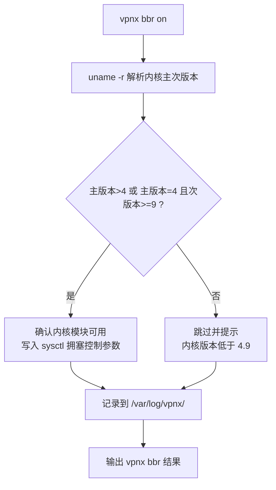
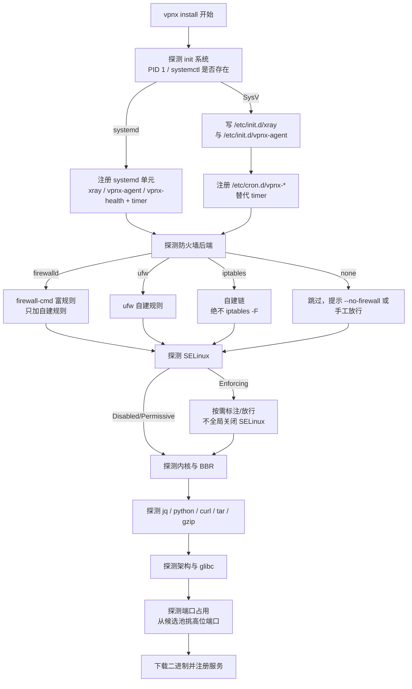
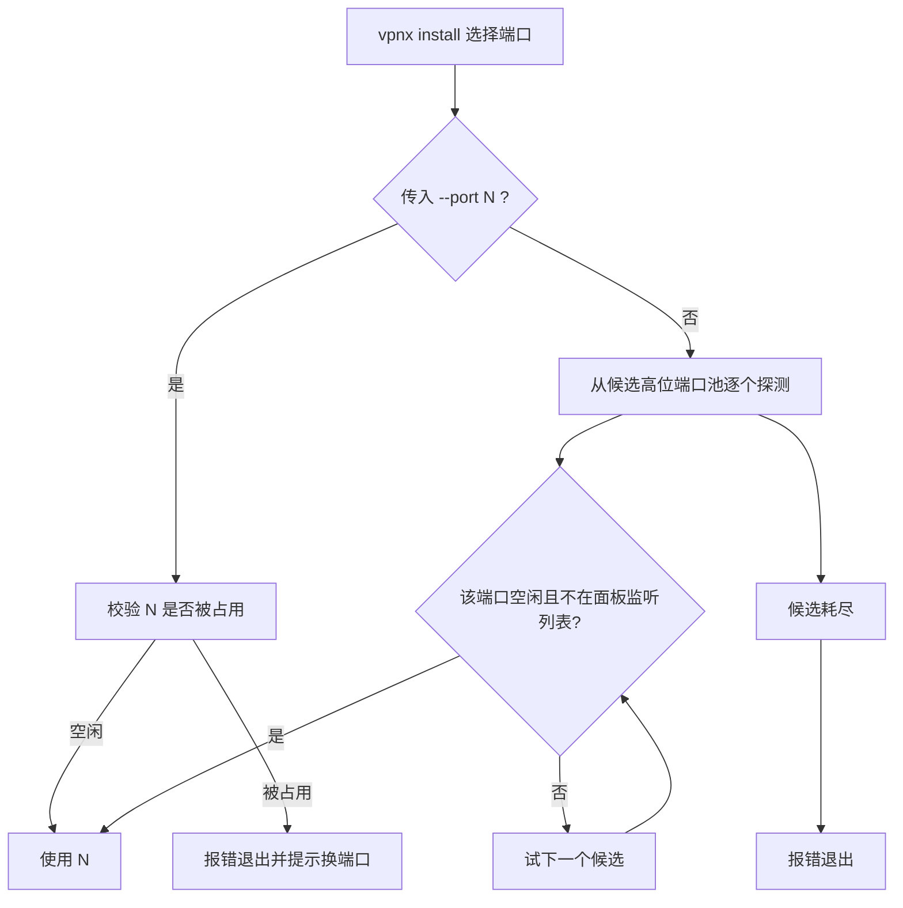
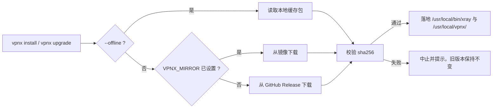

# vpnx 兼容性与共存指南

> 本文给出 **vpnx** 的发行版/架构/内核兼容矩阵、依赖探测与降级策略，以及与 **建站面板**共存的硬性约束清单。
>
> 文中命令与参数均为已确定契约；子命令的**实现细节以 `vpnx <cmd> --help` 为准**。

---

## 1. 支持范围总览

| 维度 | 支持范围 |
| --- | --- |
| 发行版家族 | CentOS 7/8、RHEL 7/8/9、AlmaLinux 8/9、Rocky 8/9、Oracle Linux 8/9、Fedora 33+、Debian 10/11/12、Ubuntu 18.04/20.04/22.04/24.04 |
| 架构 | `x86_64` / `aarch64`(arm64) / `armv7` |
| C 运行库 | glibc **2.17 起** |
| 初始化系统 | systemd（首选）；**无 systemd 的 CentOS 6 走 SysV + cron 降级路径** |
| 内核加速 | BBR 需内核 **≥ 4.9**；CentOS 7 的 3.10 自动跳过并提示 |
| 下载源 | 默认 GitHub Release；可用环境变量 `VPNX_MIRROR` 指向镜像 |
| 面板共存 | 与 建站面板 共存，见第 6 节硬性清单 |

---

## 2. 发行版兼容矩阵

图例：**✅ 完全支持** ｜ **⚠️ 支持但需降级/注意** ｜ **❌ 不支持**

### 2.1 CentOS / RHEL 系

| 发行版 | 版本 | 状态 | 默认 init | 包管理 | 需注意 |
| --- | --- | --- | --- | --- | --- |
| CentOS | 7 | ⚠️ | systemd | yum | 内核 3.10 → **BBR 自动跳过并提示**；glibc 2.17 满足下限 |
| CentOS | 8 | ✅ | systemd | dnf | 已 EOL，建议配可用镜像源 |
| CentOS | 6 | ⚠️ | **SysV** | yum | **无 systemd**：走 SysV + `/etc/cron.d/vpnx-*`；glibc 2.12，低于 2.17 下限，需实测确认 |
| RHEL | 7 | ⚠️ | systemd | yum | 同 CentOS 7（内核 3.10 跳过 BBR） |
| RHEL | 8 | ✅ | systemd | dnf | — |
| RHEL | 9 | ✅ | systemd | dnf | 默认 crypto policy 较严，REALITY 不受影响 |
| AlmaLinux | 8 | ✅ | systemd | dnf | — |
| AlmaLinux | 9 | ✅ | systemd | dnf | — |
| Rocky | 8 | ✅ | systemd | dnf | — |
| Rocky | 9 | ✅ | systemd | dnf | — |
| Oracle Linux | 8 | ✅ | systemd | dnf | UEK 内核版本较新，BBR 可用 |
| Oracle Linux | 9 | ✅ | systemd | dnf | — |
| Fedora | 33+ | ✅ | systemd | dnf | 版本推进快，仅保证已列版本起步 |

### 2.2 Debian / Ubuntu 系

| 发行版 | 版本 | 状态 | 默认 init | 包管理 | 需注意 |
| --- | --- | --- | --- | --- | --- |
| Debian | 10 (buster) | ✅ | systemd | apt | — |
| Debian | 11 (bullseye) | ✅ | systemd | apt | — |
| Debian | 12 (bookworm) | ✅ | systemd | apt | — |
| Ubuntu | 18.04 LTS | ✅ | systemd | apt | 内核 4.15，BBR 可用 |
| Ubuntu | 20.04 LTS | ✅ | systemd | apt | — |
| Ubuntu | 22.04 LTS | ✅ | systemd | apt | — |
| Ubuntu | 24.04 LTS | ✅ | systemd | apt | — |

> 上表未列出的发行版（如 Alpine、Arch、openSUSE）**不在支持范围**。它们通常缺少 glibc 或使用非 apt/yum/dnf 的包管理，未做适配。

---

## 3. 架构兼容矩阵

| 架构 | 别名 | 状态 | 说明 |
| --- | --- | --- | --- |
| `x86_64` | `amd64` | ✅ | 主力架构，绝大数 VPS |
| `aarch64` | `arm64` | ✅ | 甲骨文/华为/Ampere 等 ARM 实例 |
| `armv7` | `armhf` | ✅ | 32 位 ARM（树莓派类、部分低价实例），注意内存与 CPU 较弱 |

| glibc 下限 | 说明 |
| --- | --- |
| **2.17 起** | 二进制按此下限构建，覆盖 CentOS 7 / RHEL 7 世代及以上 |

> 低于 glibc 2.17 的环境（如 CentOS 6 的 2.12）属于**降级路径**：SysV + cron 可用，但二进制能否加载需在目标机实测；如加载失败，请使用 `--offline` 配合与目标环境匹配的本地缓存包，或升级系统。

### 3.1 架构探测命令

```bash
uname -m
getconf GNU_LIBC_VERSION 2>/dev/null || ldd --version | head -n1
```

`vpnx install` 会在安装前执行等价的探测，并把结果写入 `/var/log/vpnx/` 与 `vpnx doctor` 报告。

---

## 4. 内核与 BBR

| 内核版本 | BBR 支持 | vpnx 行为 |
| --- | --- | --- |
| ≥ 4.9 | ✅ 支持 | `vpnx bbr on` 可开启 |
| < 4.9（如 CentOS 7 的 3.10） | ❌ 不支持 | **自动跳过并给出提示**，不写入任何 sysctl 变更 |
| 无法判定 | 未知 | 保守跳过，提示人工确认 |

### 4.1 BBR 相关命令

```bash
vpnx bbr on
vpnx bbr off
vpnx install --no-bbr          # 安装时即跳过 BBR
```

### 4.2 BBR 判定逻辑



> `--no-bbr` 是安装期开关；内核不达标时即使不加该参数也会自动跳过。具体的 sysctl 落点与持久化方式**以 `vpnx bbr --help` 为准**。

---

## 5. 依赖探测与降级策略

`vpnx install` 的第一步就是环境探测。探测失败不会直接中止，而是尽量走降级路径；只有无替代方案时才报错退出。



### 5.1 init 系统：systemd → SysV 降级

| 检测项 | systemd 路径 | SysV 降级路径 |
| --- | --- | --- |
| 判定依据 | PID 1 为 `systemd` 且 `systemctl` 可用 | 无 `systemctl`（如 CentOS 6） |
| 代理引擎 | `xray.service` | `/etc/init.d/xray` |
| 中台同步 | `vpnx-agent.service` + `vpnx-agent.timer` | `/etc/init.d/vpnx-agent` + `/etc/cron.d/vpnx-agent` |
| 健康巡检 | `vpnx-health.service` + `vpnx-health.timer` | `/etc/cron.d/vpnx-health` |
| 开机自启 | `systemctl enable` | `chkconfig` / `update-rc.d` 等价操作 |
| 定时方式 | systemd timer | **`/etc/cron.d/vpnx-*`，不使用面板的 crontab** |

> 无论哪条路径，**都不写入 建站面板自带的 crontab**。vpnx 的定时任务只出现在 `/etc/cron.d/vpnx-*` 或 systemd timer 中。

### 5.2 防火墙三路适配

| 后端 | 判定依据 | vpnx 行为 | 禁止行为 |
| --- | --- | --- | --- |
| **firewalld** | `firewall-cmd --state` 返回 running | 以自建规则方式放行节点端口 | 不 `--reload` 到冲突、不删除面板已有 zone/rule |
| **ufw** | `ufw status` 可执行且存在 | 追加**自建 ufw 规则**放行节点端口 | 不 `ufw reset`、不 `ufw disable` |
| **iptables** | 存在 `iptables` 且无前两者 | 写入**自建链**并只在该链内增删 | **绝不 `iptables -F`**、绝不清空面板规则 |
| **none** | 三者皆无 | 跳过并提示需手工放行或改用 `--no-firewall` | — |

```bash
vpnx fw open      # 放行节点端口（走上述三路适配）
vpnx fw close     # 撤销 vpnx 自己写入的规则
vpnx fw status    # 展示当前后端与 vpnx 规则
vpnx install --no-firewall   # 安装时完全不动防火墙
```

> `vpnx fw close` 只撤销 vpnx 自己添加的规则，不会触碰任何面板或系统既有规则。具体链名与规则文本**以 `vpnx fw --help` 为准**。

### 5.3 SELinux

| 状态 | vpnx 行为 |
| --- | --- |
| `Disabled` | 无操作 |
| `Permissive` | 记录状态，无操作 |
| `Enforcing` | 按需为 vpnx 相关路径/端口放行，**不全局关闭 SELinux**（不设置 `SELINUX=disabled`） |

判定命令：

```bash
getenforce
sestatus 2>/dev/null | head -n5
```

> 建议保持 Enforcing，仅在 `vpnx doctor` 明确报告 AVC 拒绝时按提示做最小放行。

### 5.4 极老机器：无 jq / python

这是设计上被重点照顾的场景（也是账号库选 `|` 分隔文本的原因之一）。

| 能力 | 缺失时的降级 |
| --- | --- |
| `jq` | 不用于解析用户数据；账号库为 `|` 分隔文本，`awk` 即可 |
| `python` / `python3` | 不用于签名与 JSON 组装；改用纯 shell |
| 中台 JSON 响应解析 | 中台可返回 **`?format=lines`** 的 `key=value` 逐行格式（适用于节点策略与上报接口） |
| JSON 校验 | 若本地无校验工具，退化为渲染后由引擎自检 |

`format=lines` 协议详见 [`CENTRAL-API.md`](./CENTRAL-API.md#9-formatlines-简化协议)。

### 5.5 基础工具依赖

| 工具 | 必要性 | 缺失后果 |
| --- | --- | --- |
| `curl` 或 `wget` | 必需（联网安装时） | 无法下载二进制；可用 `--offline` 走本地缓存包 |
| `tar` / `gzip` | 必需 | 无法解包 |
| `awk` / `sed` / `grep` | 必需 | 无法解析 `users.db` 与配置 |
| `sha256sum` | 强烈建议 | 无法校验下载包完整性 |
| `ss` / `netstat` | 建议 | 端口占用探测退化为尝试绑定 |

---

## 6. 与建站面板共存清单

**总原则：vpnx 只新增自己的文件、自己的服务、自己的防火墙规则、自己的日志目录；对面板既有资产只读不改。**

### 6.1 禁止触碰项（硬性）

| # | 禁止操作 | 说明 |
| --- | --- | --- |
| 1 | 不修改/删除 `/usr/local/amh-*` 下任何内容 | 面板程序本体与配置 |
| 2 | 不修改/删除 `/home/wwwroot` 下任何内容 | 面板站点根目录 |
| 3 | 不动面板自带的 `nginx` / `apache` / `mysql` / `php` 服务 | 不 stop/restart/disable，不改其配置与 unit |
| 4 | 不占用 `80` / `443` 及面板已监听端口 | REALITY 不需要 80/443，从候选池挑高位端口 |
| 5 | 不执行 `iptables -F` 或任何形式的规则清空 | 只写自建链 / 自建 ufw 规则 |
| 6 | 不使用面板的 `crontab` | 改用 systemd timer，无 systemd 时用 `/etc/cron.d/vpnx-*` |
| 7 | 不写入面板的日志目录 | vpnx 日志统一在 `/var/log/vpnx/` |
| 8 | 不全局关闭 `SELinux` | 仅按需最小放行 |
| 9 | 不替换系统包管理器中的 `nginx`/`php`/`mysql` 包 | 不需要这些依赖 |

### 6.2 端口避让策略



| 规则 | 说明 |
| --- | --- |
| 端口来源 | 候选池自动挑选**未占用的高位端口** |
| 显式指定 | `vpnx install --port N`，若 N 已被占用则报错 |
| 保留端口 | 不选 `80` / `443`；不选面板与系统服务已监听端口 |
| 探测手段 | 优先 `ss` / `netstat`，缺失时退化为尝试绑定 |
| 绑定地址 | 监听在节点公网服务端口，不与面板 Web 服务冲突 |

### 6.3 防火墙共存

| 要求 | 做法 |
| --- | --- |
| 只写自建内容 | firewalld 富规则 / ufw 自建规则 / iptables 自建链 |
| 绝不清空 | 不做 `iptables -F`，不 `ufw reset`，不删面板 zone/rule |
| 可逆 | `vpnx fw close` 只撤销 vpnx 自己写入的规则 |
| 可跳过 | `vpnx install --no-firewall`；之后可用 `vpnx fw open` 补放行 |

### 6.4 日志与文件隔离

| 类别 | vpnx 落点 | 面板落点（vpnx 不触碰） |
| --- | --- | --- |
| 运行日志 | `/var/log/vpnx/` | 面板自身日志目录 |
| 配置 | `/etc/vpnx/` | `/usr/local/amh-*` |
| 站点文件 | 无（vpnx 不建站点） | `/home/wwwroot` |
| 定时任务 | systemd timer 或 `/etc/cron.d/vpnx-*` | 面板 crontab |
| 二进制 | `/usr/local/bin/xray`、`/usr/local/vpnx/` | 面板自带二进制 |

### 6.5 共存自检清单

安装后逐项确认（`vpnx doctor` 会输出同类检查结果）：

| # | 检查项 | 期望结果 |
| --- | --- | --- |
| 1 | `ls /usr/local/amh-*` 内容与安装前一致 | 未改动 |
| 2 | 面板站点可正常访问（80/443） | 未受影响 |
| 3 | 面板服务状态正常 | 未重启/未停止 |
| 4 | `vpnx status` 显示节点端口与面板端口不重叠 | 无冲突 |
| 5 | `vpnx fw status` 只显示 vpnx 自建规则 | 无清空行为 |
| 6 | 面板 crontab 中无 vpnx 条目 | 定时任务在 timer 或 `/etc/cron.d/` |
| 7 | `/var/log/vpnx/` 有日志，面板日志目录无 vpnx 写入 | 日志隔离 |

---

## 7. 下载源与镜像

| 项 | 默认 | 覆盖方式 |
| --- | --- | --- |
| 二进制/脚本下载源 | **GitHub Release** | 环境变量 `VPNX_MIRROR` 指向镜像 |
| 联网模式 | 默认联网 | 全局参数 `--offline` 使用**本地缓存包、不联网** |

```bash
# 使用镜像源安装
VPNX_MIRROR=https://mirror.example.com/vpnx vpnx install

# 离线安装（使用本地缓存包）
vpnx install --offline
```



> 镜像目录结构与文件命名需与 GitHub Release 一致；具体路径规则**以 `vpnx install --help` 与 `vpnx upgrade --help` 为准**。

---

## 8. 兼容性相关命令速查

| 目的 | 命令 |
| --- | --- |
| 安装（可跳过防火墙/BBR） | `vpnx install --no-firewall --no-bbr` |
| 指定端口与 SNI | `vpnx install --port 8443 --sni www.example.com` |
| 选择协议档位 | `vpnx install --profiles reality,ss2022,vmess-ws,xhttp` |
| 环境体检 | `vpnx doctor` |
| 状态概览 | `vpnx status` |
| 防火墙三路适配 | `vpnx fw open` / `vpnx fw close` / `vpnx fw status` |
| BBR 开关 | `vpnx bbr on` / `vpnx bbr off` |
| 健康检查与自愈 | `vpnx health check` / `vpnx health fix` / `vpnx health watch` |
| 离线安装 | `vpnx install --offline` |
| 演练（不落地） | `vpnx install --dry-run` |

> 全局参数：`--dry-run`、`--yes`、`--debug`、`--offline`。全部子命令的**实现细节以 `vpnx <cmd> --help` 为准**。

---

## 9. 相关文档

| 文档 | 内容 |
| --- | --- |
| [`ARCHITECTURE.md`](./ARCHITECTURE.md) | 节点模块结构、数据流、渲染管线、中台时序 |
| [`OPERATIONS.md`](./OPERATIONS.md) | 部署、日常运维、故障排查、备份与升级 |
| [`CENTRAL-API.md`](./CENTRAL-API.md) | 中台接口契约与签名 |
| [`ROADMAP.md`](./ROADMAP.md) | 后续阶段规划 |