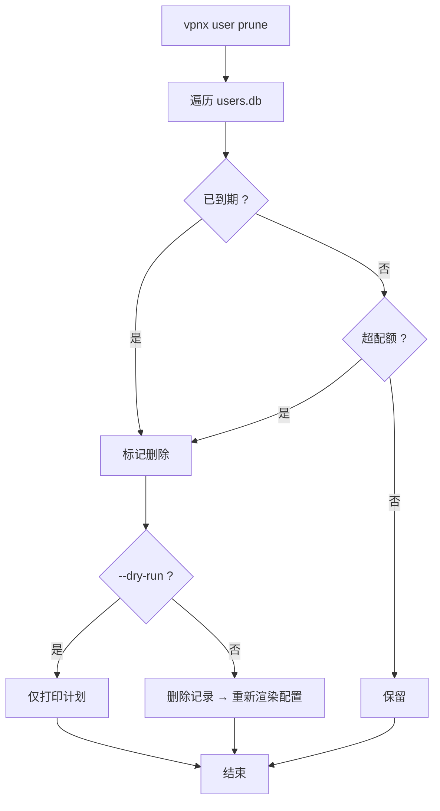
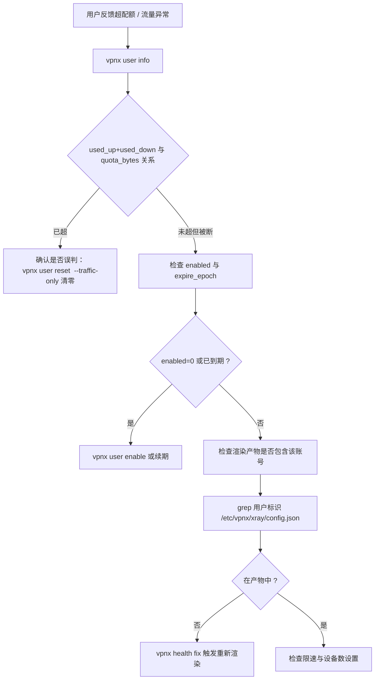
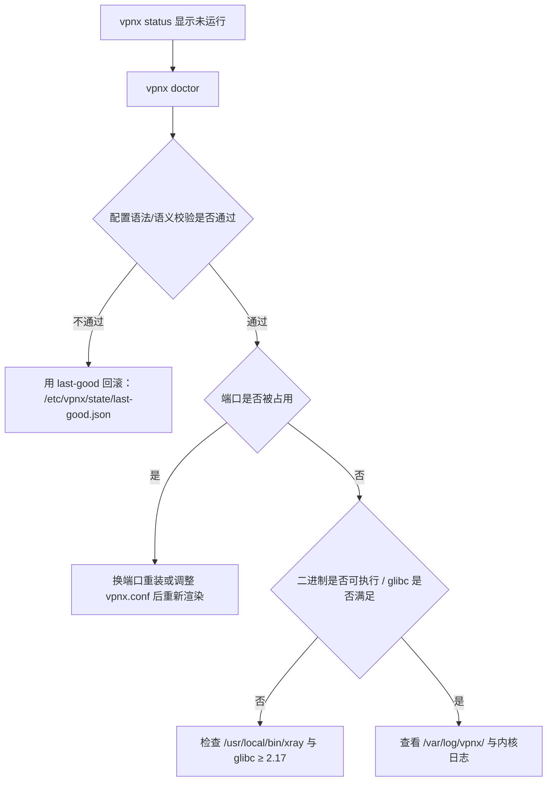
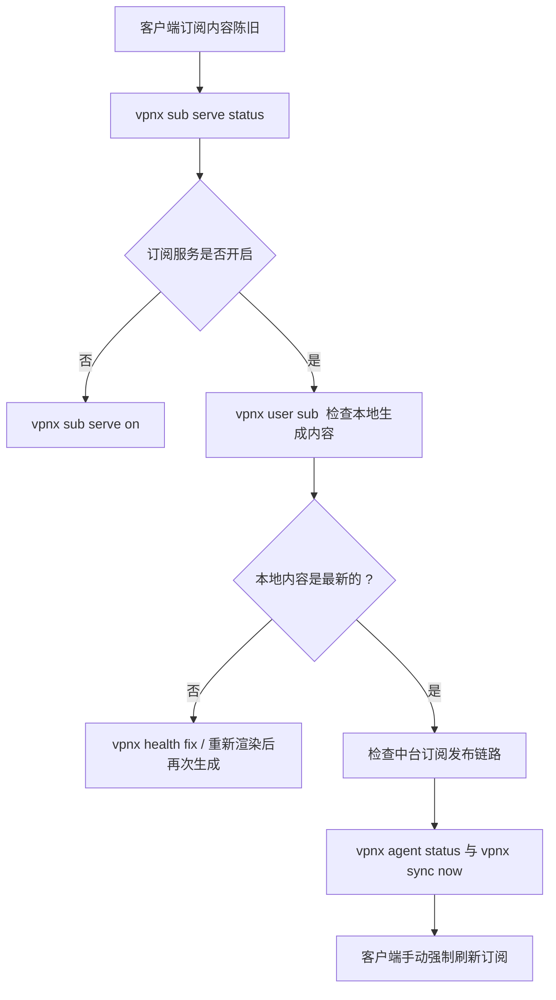
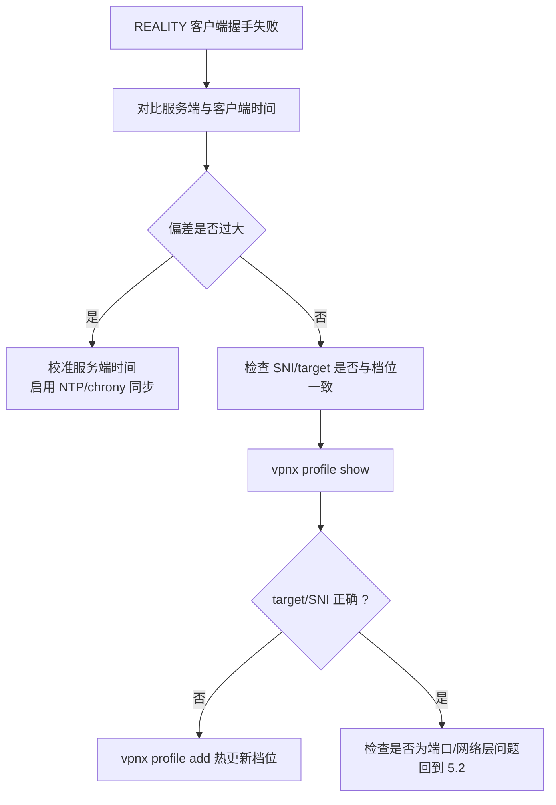
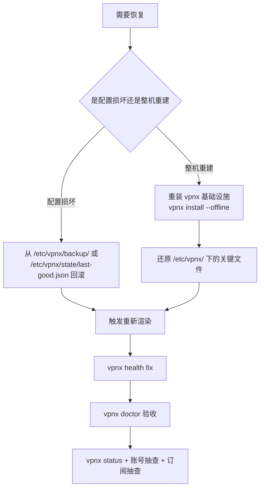
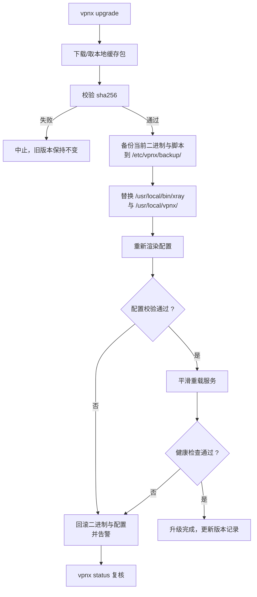

# vpnx 运维手册

> 面向节点管理员的实操文档：首次部署、日常命令、账号管理、流量排查、故障定位、备份恢复、升级回滚。
>
> 文中命令与参数均为已确定契约；子命令的**实现细节以 `vpnx <cmd> --help` 为准**。
>
> 约定：需要 root 权限的命令前面用 `#` 表示；示例中的 `alice`、`1.2.3.4`、`vpnx.example.com` 均为占位符。

---

## 1. 首次部署五步


### 第 1 步：环境体检

确认系统受支持、内核与 init 系统情况、面板是否存在。

```bash
# 系统与内核
cat /etc/os-release
uname -m
uname -r

# glibc 版本（需 2.17 起）
getconf GNU_LIBC_VERSION 2>/dev/null || ldd --version | head -n1

# init 系统
ps -p 1 -o comm=

# 端口占用情况（ss 缺失时用 netstat）
ss -lntp 2>/dev/null || netstat -lntp 2>/dev/null

# 是否安装 建站面板
ls -d /usr/local/amh-* 2>/dev/null
```

判定要点：

| 检查 | 期望 |
| --- | --- |
| 发行版 | 在支持矩阵内，见 [`COMPATIBILITY.md`](./COMPATIBILITY.md) |
| 架构 | `x86_64` / `aarch64` / `armv7` |
| glibc | ≥ 2.17 |
| PID 1 | `systemd` 走标准路径；否则走 SysV + cron 降级 |
| 端口 | 80/443 可能被面板占用，vpnx 会另选高位端口 |

### 第 2 步：安装部署

```bash
# 最小安装（端口与 SNI 自动选择，按候选池挑未占用高位端口）
vpnx install

# 演练：只做探测与渲染校验，不落地
vpnx install --dry-run

# 显式指定端口与借用 SNI
vpnx install --port 8443 --sni www.example.com

# 只启用需要的档位
vpnx install --profiles reality,ss2022

# 与面板共存时完全不动防火墙，稍后手工放行
vpnx install --no-firewall

# 跳过 BBR（内核 < 4.9 时本身也会自动跳过）
vpnx install --no-bbr

# 离线环境：使用本地缓存包，不联网
vpnx install --offline

# 一步到位并带上中台纳管参数
vpnx install --port 8443 \
  --profiles reality,ss2022,vmess-ws,xhttp \
  --central-url https://vpnx.example.com \
  --node-id node-hk-01 \
  --token 'REPLACE_WITH_NODE_SECRET'
```

安装完成后立即确认：

```bash
vpnx status
vpnx doctor
```

`vpnx install` 的完整参数：

| 参数 | 含义 |
| --- | --- |
| `--port N` | 指定监听端口；被占用则报错 |
| `--sni domain` | 指定 REALITY 借用的 SNI/目标站点 |
| `--profiles reality,ss2022,vmess-ws,xhttp` | 启用的协议档位（逗号分隔） |
| `--central-url URL` | 中台地址 |
| `--node-id ID` | 节点 ID |
| `--token SECRET` | 节点密钥（HMAC 签名用） |
| `--no-firewall` | 不改动防火墙 |
| `--no-bbr` | 不开启 BBR |
| `--dry-run` | 演练，不落地 |

### 第 3 步：放行端口

如果安装时用了 `--no-firewall`，或需要核对规则：

```bash
vpnx fw status    # 查看当前防火墙后端与 vpnx 自建规则
vpnx fw open      # 放行节点端口（firewalld / ufw / iptables 三路适配）
vpnx fw close     # 撤销 vpnx 自己写入的规则
```

核对清单：

| 检查 | 说明 |
| --- | --- |
| 只新增自建规则 | 绝不 `iptables -F`，不清空面板规则 |
| 未触碰面板 | `/usr/local/amh-*`、面板服务、面板 crontab 均未变 |
| 端口正确 | `vpnx fw status` 中的端口等于 `vpnx status` 报告的节点端口 |

### 第 4 步：创建账号

```bash
# 创建 30 天有效、100G 配额、限速 100Mbps、最多 3 台设备、仅 reality 协议
vpnx user add alice \
  --expire 30d \
  --quota 100G \
  --speed 100 \
  --devices 3 \
  --protocols reality \
  --note '首批测试'

# 查看连接信息与订阅
vpnx user info alice
vpnx user link alice
vpnx user sub alice
```

### 第 5 步：验收与纳管

```bash
# 账号清单（含流量）
vpnx user list --traffic

# 客户端兼容性验收：用 Shadowrocket / v2rayN / Clash Meta(Mihomo) / sing-box / Stash
# 通过中台订阅 URL 拉取，分别验证 base64 / clash / singbox 三种格式

# 开启订阅服务并导出
vpnx sub serve on
vpnx sub serve status
vpnx sub export

# 接入中台
vpnx agent install
vpnx agent set --url https://vpnx.example.com --node-id node-hk-01 --token 'REPLACE_WITH_NODE_SECRET'
vpnx agent status
vpnx agent run-once
vpnx sync now
```

验收清单：

| # | 项目 | 通过标准 |
| --- | --- | --- |
| 1 | 引擎 | `vpnx status` 显示运行中 |
| 2 | 端口 | 外部可连通节点端口 |
| 3 | 账号 | `vpnx user info <name>` 显示正确配额与到期 |
| 4 | 协议 | reality / ss2022 / vmess-ws 至少一种握手成功 |
| 5 | 订阅 | 三种 target 格式均可被对应客户端解析 |
| 6 | 中台 | `vpnx agent status` 显示心跳正常 |
| 7 | 面板 | 站点与面板服务不受影响 |

---

## 2. 日常命令速查表

### 2.1 生命周期与状态

| 目的 | 命令 |
| --- | --- |
| 安装 | `vpnx install [--port N] [--sni domain] [--profiles reality,ss2022,vmess-ws] [--central-url URL] [--node-id ID] [--token SECRET] [--no-firewall] [--no-bbr] [--dry-run]` |
| 卸载 | `vpnx uninstall` |
| 彻底卸载（含配置与数据） | `vpnx uninstall --purge` |
| 升级 | `vpnx upgrade [--version vX.Y.Z]` |
| 状态概览 | `vpnx status` |
| 环境体检 | `vpnx doctor` |

### 2.2 账号管理

| 目的 | 命令 |
| --- | --- |
| 新增 | `vpnx user add <name> [--expire 2026-01-31\|30d] [--quota 100G] [--speed 100] [--devices 3] [--protocols reality,ss2022] [--note TEXT]` |
| 删除 | `vpnx user del <name>` |
| 启用 | `vpnx user enable <name>` |
| 停用 | `vpnx user disable <name>` |
| 重置 | `vpnx user reset <name> [--traffic-only]` |
| 详情 | `vpnx user info <name>` |
| 列表 | `vpnx user list [--traffic]` |
| 连接链接 | `vpnx user link <name>` |
| 订阅内容 | `vpnx user sub <name>` |
| 批量清理 | `vpnx user prune` |

### 2.3 订阅

| 目的 | 命令 |
| --- | --- |
| 开启订阅服务 | `vpnx sub serve on` |
| 关闭订阅服务 | `vpnx sub serve off` |
| 订阅服务状态 | `vpnx sub serve status` |
| 导出订阅 | `vpnx sub export` |

### 2.4 中台与策略

| 目的 | 命令 |
| --- | --- |
| 安装 agent | `vpnx agent install` |
| 卸载 agent | `vpnx agent uninstall` |
| 手动跑一轮同步 | `vpnx agent run-once` |
| agent 状态 | `vpnx agent status` |
| 设置中台参数 | `vpnx agent set --url URL --node-id ID --token SECRET` |
| 立即同步 | `vpnx sync now` |
| 应用策略 | `vpnx policy apply <file\|->` |
| 拉取策略 | `vpnx policy pull` |
| 查看当前策略 | `vpnx policy show` |

### 2.5 档位、健康、网络

| 目的 | 命令 |
| --- | --- |
| 列出档位 | `vpnx profile list` |
| 查看档位 | `vpnx profile show <name>` |
| 新增/热更新档位 | `vpnx profile add <file>` |
| 健康检查 | `vpnx health check` |
| 健康自愈 | `vpnx health fix` |
| 持续观察 | `vpnx health watch` |
| 放行端口 | `vpnx fw open` |
| 撤销放行 | `vpnx fw close` |
| 防火墙状态 | `vpnx fw status` |
| 开启 BBR | `vpnx bbr on` |
| 关闭 BBR | `vpnx bbr off` |

### 2.6 全局参数

| 参数 | 含义 |
| --- | --- |
| `--dry-run` | 只演练，不落地修改 |
| `--yes` | 跳过交互确认 |
| `--debug` | 输出调试信息 |
| `--offline` | 使用本地缓存包，不联网 |

> 全局参数可与多数子命令组合使用，例如 `vpnx user prune --dry-run --yes`。具体支持范围**以 `vpnx <cmd> --help` 为准**。

---

## 3. 账号增删改查示例

### 3.1 新增账号

```bash
# 绝对日期到期
vpnx user add alice --expire 2026-01-31 --quota 100G --speed 100 --devices 3 \
  --protocols reality,ss2022 --note '长期客户'

# 相对天数到期
vpnx user add bob --expire 30d --quota 50G --protocols reality

# 不限量、不限速、不限期
vpnx user add test --quota 0 --speed 0 --expire 0

# 演练：只看会写什么，不真写
vpnx user add carol --expire 7d --quota 10G --dry-run
```

新增后核对：

```bash
vpnx user info alice
```

### 3.2 查询账号

```bash
vpnx user info alice          # 单个账号详情
vpnx user list                # 账号清单
vpnx user list --traffic      # 清单 + 流量
vpnx user link alice          # 直连链接（可导入客户端）
vpnx user sub alice           # 该账号订阅内容
```

### 3.3 变更账号状态

```bash
vpnx user disable alice       # 临时停用（enabled=0，渲染时跳过）
vpnx user enable alice        # 恢复
vpnx user reset alice                 # 重置（含用量与凭据）
vpnx user reset alice --traffic-only  # 仅清零用量，用于超配额恢复
```

> 续期：契约中未单列「修改到期时间」的子命令。`--expire` 属于 `vpnx user add` 的参数；对已存在账号如需调整到期时间，请先用 `vpnx user info <name>` 确认现状，再按 `vpnx user reset <name> --help` 的说明执行。**不要手工编辑 `/etc/vpnx/users.db`。**

### 3.4 删除与批量清理

```bash
vpnx user del alice                    # 删除单个账号
vpnx user prune --dry-run              # 预览：哪些会被清理
vpnx user prune                        # 批量清理到期/超配额账号
vpnx user prune --dry-run --yes        # 非交互预览
```

`vpnx user prune` 的处理范围：**已到期**（`expire_epoch` 已过）与**超配额**（`used_up + used_down >= quota_bytes` 且 `quota_bytes > 0`）的账号。



### 3.5 账号字段速查

账号库 `/etc/vpnx/users.db` 字段顺序（`|` 分隔）：

```
name|uuid|enabled|expire_epoch|quota_bytes|used_up|used_down|speed_mbps|max_devices|protocols(csv)|ss_user_psk|sub_token|created_epoch|note
```

只读排查示例：

```bash
# 查看全部账号（原始记录）
cat /etc/vpnx/users.db

# 只看某个账号
grep '^alice|' /etc/vpnx/users.db

# 列出账号名、enabled、到期、配额、已用
awk -F'|' '{print $1, $3, $4, $5, $6+$7}' /etc/vpnx/users.db

# 列出已停用的账号
awk -F'|' '$3==0 {print $1}' /etc/vpnx/users.db
```

> **不要直接编辑 `users.db`**。绕过 CLI 的写入不会触发配置重新渲染，且容易破坏 `|` 分隔结构。需要批量操作时请用 CLI 子命令。

---

## 4. 流量与配额排查

### 4.1 数据来源

| 数据 | 位置 | 说明 |
| --- | --- | --- |
| 账号累计用量 | `users.db` 的 `used_up` / `used_down` | 字节 |
| 用量中间状态与快照 | `/etc/vpnx/state/` | 采集与上报之间的暂存 |
| 中台侧汇总 | 中台 `/api/v1/node/report` 接收的数据 | 需 agent 正常运行 |

### 4.2 排查流程



### 4.3 常用命令

```bash
# 单账号用量
vpnx user info alice

# 全量账号用量
vpnx user list --traffic

# 直接看累计用量（原始记录）
awk -F'|' '{printf "%-20s up=%s down=%s quota=%s\n", $1, $6, $7, $5}' /etc/vpnx/users.db

# 找出接近或超过配额的账号（quota>0 且 已用>=配额）
awk -F'|' '$5>0 && ($6+$7)>=$5 {print $1}' /etc/vpnx/users.db
```

### 4.4 配额相关行为

| 情况 | 行为 | 恢复方式 |
| --- | --- | --- |
| `quota_bytes = 0` | 不限量，永不因配额被跳过 | — |
| `used_up + used_down >= quota_bytes` | 渲染时跳过该账号（客户端连不上） | `vpnx user reset <name> --traffic-only` |
| 到期 `expire_epoch` 已过 | 渲染时跳过（`enabled` 不改写） | 续期覆盖 `--expire` |
| `enabled = 0` | 渲染时跳过 | `vpnx user enable <name>` |

---

## 5. 常见故障排查

### 5.1 服务起不来



排查步骤：

```bash
# 1. 概览
vpnx status

# 2. 体检（会给出具体失败项）
vpnx doctor

# 3. systemd 环境
systemctl status xray.service
journalctl -u xray.service -n 100 --no-pager

# SysV 环境
/etc/init.d/xray status

# 4. 手动前台启动，看即时错误
/usr/local/bin/xray run -c /etc/vpnx/xray/config.json

# 5. 端口占用
ss -lntp 2>/dev/null | grep -E ':(443|8443)\b'

# 6. 配置产物是否与账号库一致
vpnx health fix
```

常见原因与处置：

| 现象 | 常见原因 | 处置 |
| --- | --- | --- |
| 立即退出、报配置错误 | 渲染产物被手改或损坏 | `vpnx health fix` 重新渲染；必要时从 `/etc/vpnx/state/last-good.json` 回滚 |
| 报端口已被占用 | 与面板或其他服务冲突 | 换端口：`vpnx install --port <新端口>` 或改配置后重新渲染 |
| 报无法执行二进制 | 架构不匹配 / glibc 过低 | 换对应架构包；`--offline` 指定匹配的本地缓存包 |
| 启动后被立即杀掉 | 内存不足 | 检查 `free -m`；减少档位或降低并发 |

### 5.2 端口被封

**特征**：节点进程正常、本机 `ss -lntp` 能看到监听，但境外客户端握手超时；`vpnx health check` 报告的连通性探测失败。

处置顺序：

```bash
# 1. 确认本机确实在监听
vpnx status
ss -lntp 2>/dev/null | grep <节点端口>

# 2. 确认防火墙不是本地问题
vpnx fw status

# 3. 从境外另一台机器测试端口连通性（示例，目标为节点）
#    nc -vz <节点IP> <节点端口>
#    curl -v telnet://<节点IP>:<节点端口>

# 4. 换端口（REALITY 不需要 80/443，换端口成本低）
vpnx install --port <新高位端口>
vpnx fw open
```

| 判断 | 结论 |
| --- | --- |
| 本机监听正常 + 外部完全不通 + 换端口后恢复 | 端口级封锁 |
| 换端口仍不通，且换 SNI 后恢复 | SNI/指纹相关，参考 5.4 |
| 只有部分境外网络不通 | 运营商侧丢包/限速，考虑后续多节点与中转（见 ROADMAP） |

> 自动换端口与自动换 IP 属于后续阶段能力，见 [`ROADMAP.md`](./ROADMAP.md)。

### 5.3 订阅不更新



排查步骤：

```bash
# 1. 订阅服务状态
vpnx sub serve status

# 2. 本地生成的订阅内容
vpnx user sub alice

# 3. 导出全部订阅核对
vpnx sub export

# 4. 中台链路
vpnx agent status
vpnx sync now
```

要点：

| 要点 | 说明 |
| --- | --- |
| 响应头 | 中台订阅响应带 `Subscription-Userinfo` 与 `Profile-Update-Interval` |
| 更新周期 | 客户端按 `Profile-Update-Interval` 自动刷新；期间不会立刻变 |
| 三种格式 | `?target=base64\|raw\|clash\|singbox`，不同客户端取不同格式 |
| 令牌变更 | 若 `sub_token` 变化，旧订阅 URL 失效，需重新分发 |
| 账号被跳过 | 账号到期/超配额/停用后不会出现在订阅中，这属于预期行为 |

### 5.4 时间不同步导致 REALITY 失败

**这是 REALITY 最典型的故障**：服务端与客户端时间偏差过大时，TLS 握手校验失败，表现为"配置看起来完全正确但就是连不上"。



处置：

```bash
# 1. 查看服务端时间与时区
date
timedatectl 2>/dev/null

# 2. 与可靠时间源对比偏差
#    chronyc tracking 2>/dev/null || ntpq -p 2>/dev/null

# 3. 校时（按发行版选择）
#    systemctl enable --now chronyd   # RHEL 系
#    systemctl enable --now systemd-timesyncd  # Debian/Ubuntu

# 4. 与中台交互同样依赖时间（时间窗 300 秒）
vpnx agent status
vpnx agent run-once
```

| 关联影响 | 说明 |
| --- | --- |
| REALITY 握手 | 服务端/客户端时间偏差过大会导致握手失败 |
| 中台签名 | `X-VPNX-Timestamp` 超出 **300 秒**窗口即被拒绝，报签名/时间错误 |
| nonce 防重放 | 时间正确但 nonce 重复同样会被拒 |

### 5.5 面板冲突

**特征**：安装后面板站点异常、面板服务被重启、80/443 被抢占、面板 crontab 被写入。

处置与核对：

```bash
# 1. 面板目录是否被改动
ls -la /usr/local/amh-* 2>/dev/null

# 2. 面板 Web 服务是否仍在运行且未被 vpnx 触碰
systemctl status nginx 2>/dev/null
systemctl status httpd 2>/dev/null

# 3. vpnx 端口是否与面板/系统端口冲突
vpnx status
ss -lntp 2>/dev/null

# 4. 防火墙是否只含 vpnx 自建规则
vpnx fw status

# 5. 面板 crontab 中是否出现 vpnx 条目（应为无）
crontab -l 2>/dev/null | grep -i vpnx

# 6. vpnx 的定时任务应在
ls -la /etc/cron.d/vpnx-* 2>/dev/null
systemctl list-timers | grep vpnx
```

| 冲突现象 | 原因 | 处置 |
| --- | --- | --- |
| 80/443 被占用导致面板站点异常 | 端口选择不当 | 换高位端口重装；REALITY 不需要 80/443 |
| 面板规则丢失 | 误执行了 `iptables -F`（vpnx 不会做） | 立即从面板/系统备份恢复规则；核对 `vpnx fw status` |
| 面板任务被改 | 误用面板 crontab | 删除误写条目；vpnx 任务应在 `/etc/cron.d/vpnx-*` 或 timer |
| SELinux 拒绝 | Enforcing 且未放行 | 按 `vpnx doctor` 提示最小放行，不全局关闭 |
| 日志混淆 | 写入了面板日志目录 | vpnx 日志统一在 `/var/log/vpnx/` |

**vpnx 的硬性保证**：不触碰 `/usr/local/amh-*`、`/home/wwwroot`、面板自带 nginx/apache/mysql/php 服务与端口；不使用面板 crontab；绝不 `iptables -F`。详见 [`COMPATIBILITY.md`](./COMPATIBILITY.md#6-与建站面板共存清单)。

---

## 6. 日志位置与关键日志片段

### 6.1 日志位置

| 位置 | 内容 |
| --- | --- |
| `/var/log/vpnx/` | vpnx 全部日志（**唯一日志根目录**，不写面板日志目录） |
| `/etc/vpnx/state/` | 用量、锁、`last-good.json`（非日志，但排查必看） |
| `/etc/vpnx/backup/` | 变更前备份 |
| `journalctl -u xray.service` | systemd 环境下的引擎日志 |
| `journalctl -u vpnx-agent.service` | systemd 环境下的 agent 日志 |

### 6.2 关键日志片段（排查时重点搜索）

以下是排查时应在 `/var/log/vpnx/` 中重点定位的信息类型（`vpnx --debug` 会输出更详细内容）：

| 关键词/主题 | 代表什么 | 下一步 |
| --- | --- | --- |
| 端口选择与占用 | 渲染/安装时的端口挑选举措 | 确认是否与面板冲突 |
| 配置校验失败 | 新产物未通过校验 | 检查 `last-good.json` 是否已回滚 |
| 服务重载 | 平滑重载成功/失败 | 失败时看引擎日志 |
| 账号渲染 | 某账号被跳过及其原因（disabled/expired/over-quota） | 用 `vpnx user info` 核对 |
| 心跳与签名 | 中台心跳结果、签名/时间窗/nonce 错误 | 校时；核对 `agent.conf` 的 node_id/token |
| 策略应用与 ack | `applied` / `failed` 与 revision | `vpnx policy show` |
| 档位热更新 | 档位包签名校验与落地 | `vpnx profile list` |
| 健康检查结果 | 端口/进程/握手/时间/磁盘各项结论 | `vpnx health fix` |

常用查看命令：

```bash
# 最近日志
ls -la /var/log/vpnx/
tail -n 200 /var/log/vpnx/*.log 2>/dev/null

# 调试级别重跑某命令
vpnx doctor --debug

# systemd 日志
journalctl -u xray.service -n 200 --no-pager
journalctl -u vpnx-agent.service -n 200 --no-pager
```

> 具体日志文件名与格式**以节点实际安装结果为准**；`/var/log/vpnx/` 是唯一约定的日志根目录。

---

## 7. 备份与恢复

### 7.1 需要备份的内容

| 路径 | 重要性 | 说明 |
| --- | --- | --- |
| `/etc/vpnx/vpnx.conf` | 高 | 节点主配置（端口、SNI、启用档位、服务器 PSK） |
| `/etc/vpnx/users.db` | 高 | 账号库，丢失等于所有账号失效 |
| `/etc/vpnx/agent.conf` | 高 | 中台参数（含 token，注意保密） |
| `/etc/vpnx/profiles/` | 中 | 加密与传输档位 |
| `/etc/vpnx/policy.applied.json` | 中 | 当前生效策略 |
| `/etc/vpnx/state/last-good.json` | 中 | 最近一次确认可用的配置 |
| `/etc/vpnx/sub/` | 低 | 可由账号库重建 |
| `/etc/vpnx/xray/config.json` | 低 | 渲染产物，可重建 |

### 7.2 备份

```bash
# vpnx 自身备份目录（升级/变更前会自动使用）
ls -la /etc/vpnx/backup/

# 手工打包关键配置
tar czf /root/vpnx-backup-$(date +%F).tar.gz \
  /etc/vpnx/vpnx.conf \
  /etc/vpnx/users.db \
  /etc/vpnx/agent.conf \
  /etc/vpnx/profiles \
  /etc/vpnx/policy.applied.json \
  /etc/vpnx/state/last-good.json
```

> 备份包含 token 与 PSK，请按密钥对待：限制权限（如 `chmod 600`）并加密传输/存放。

### 7.3 恢复



```bash
# 1. 解包备份
tar xzf /root/vpnx-backup-YYYY-MM-DD.tar.gz -C /

# 2. 修正权限（按需）
chmod 600 /etc/vpnx/agent.conf

# 3. 由配置与账号库重新渲染产物
vpnx health fix

# 4. 验收
vpnx doctor
vpnx status
vpnx user list --traffic
```

### 7.4 恢复检查表

| # | 检查 | 命令 |
| --- | --- | --- |
| 1 | 环境体检通过 | `vpnx doctor` |
| 2 | 服务运行 | `vpnx status` |
| 3 | 账号数量与用量符合预期 | `vpnx user list --traffic` |
| 4 | 端口与防火墙一致 | `vpnx fw status` |
| 5 | 中台心跳恢复 | `vpnx agent status` |
| 6 | 抽一个账号实测握手 | `vpnx user link <name>` |

---

## 8. 升级与回滚

### 8.1 升级

```bash
# 升级到最新
vpnx upgrade

# 升级到指定版本
vpnx upgrade --version vX.Y.Z

# 演练
vpnx upgrade --dry-run

# 离线升级（本地缓存包）
vpnx upgrade --offline
```

升级前建议：

```bash
vpnx status
vpnx doctor

tar czf /root/vpnx-preupgrade-$(date +%F).tar.gz \
  /etc/vpnx/vpnx.conf /etc/vpnx/users.db /etc/vpnx/agent.conf \
  /etc/vpnx/profiles /etc/vpnx/policy.applied.json
```

### 8.2 升级流程与回滚



回滚方式：

| 场景 | 做法 |
| --- | --- |
| 升级后服务异常 | `vpnx upgrade --version <上一个版本>` 降级回退 |
| 仅配置异常 | 从 `/etc/vpnx/state/last-good.json` 回滚后 `vpnx health fix` |
| 二进制损坏 | 从 `/etc/vpnx/backup/` 恢复二进制与脚本 |
| 需要完全重来 | 备份 `/etc/vpnx/` 关键文件 → `vpnx uninstall`（**不加** `--purge`）→ `vpnx install` → 还原文件 |

### 8.3 卸载

```bash
vpnx uninstall            # 卸载服务与程序，保留 /etc/vpnx 配置与账号库
vpnx uninstall --purge    # 连同配置与数据一起清理
```

| 参数 | 行为 |
| --- | --- |
| 无参数 | 停止并注销服务，移除程序，**保留** `/etc/vpnx/` |
| `--purge` | 同时清理 `/etc/vpnx/` 与相关数据 |

> `--purge` 会删除 `users.db` 与 `agent.conf`，**不可逆**。执行前务必先备份（见第 7 节）。

---

## 9. 例行维护建议

| 周期 | 动作 | 命令 |
| --- | --- | --- |
| 每日 | 状态与健康 | `vpnx status`、`vpnx health check` |
| 每日 | 中台同步确认 | `vpnx agent status` |
| 每周 | 清理到期/超配额账号 | `vpnx user prune --dry-run` → `vpnx user prune` |
| 每周 | 用量巡检 | `vpnx user list --traffic` |
| 每月 | 配置异地备份 | 见 7.2 |
| 每月 | 体检与版本核对 | `vpnx doctor` |
| 按需 | 档位热更新 | `vpnx profile add <file>` |
| 按需 | 策略应用 | `vpnx policy apply <file\|->`、`vpnx policy pull` |

---

## 10. 相关文档

| 文档 | 内容 |
| --- | --- |
| [`ARCHITECTURE.md`](./ARCHITECTURE.md) | 节点模块结构、渲染管线、中台时序 |
| [`COMPATIBILITY.md`](./COMPATIBILITY.md) | 兼容矩阵、降级策略、建站面板 共存清单 |
| [`CENTRAL-API.md`](./CENTRAL-API.md) | 中台接口契约、签名、revision/ack |
| [`ROADMAP.md`](./ROADMAP.md) | 后续阶段规划 |
