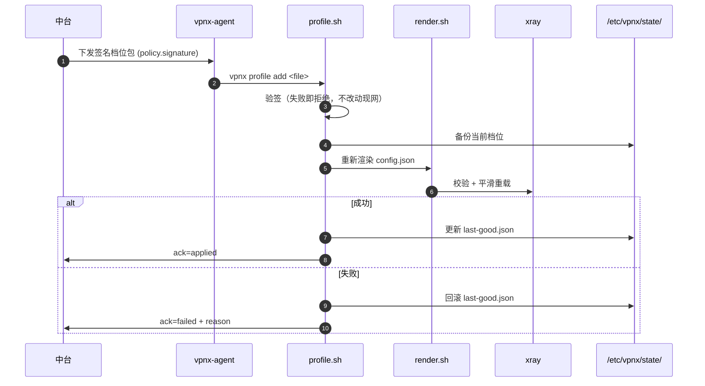
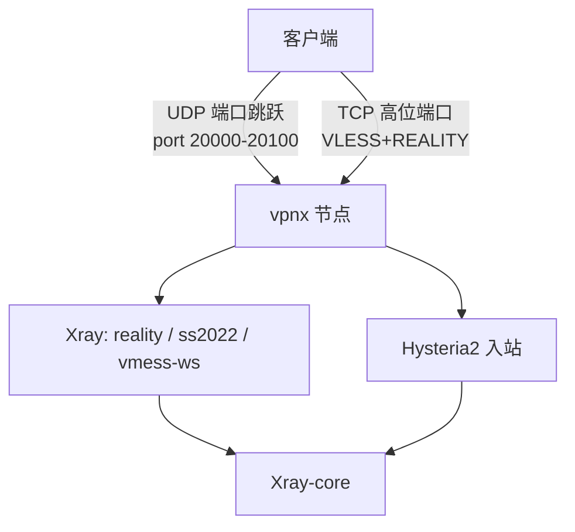
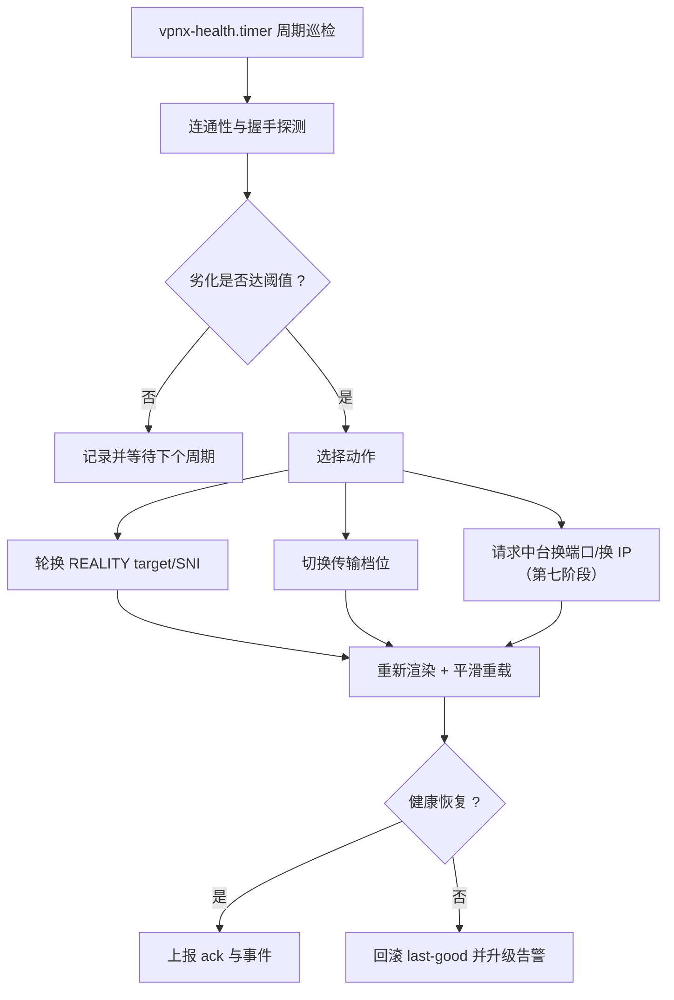
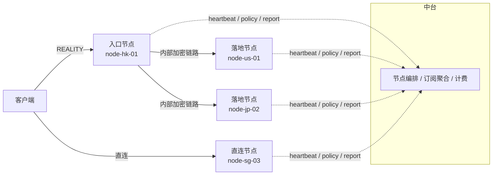
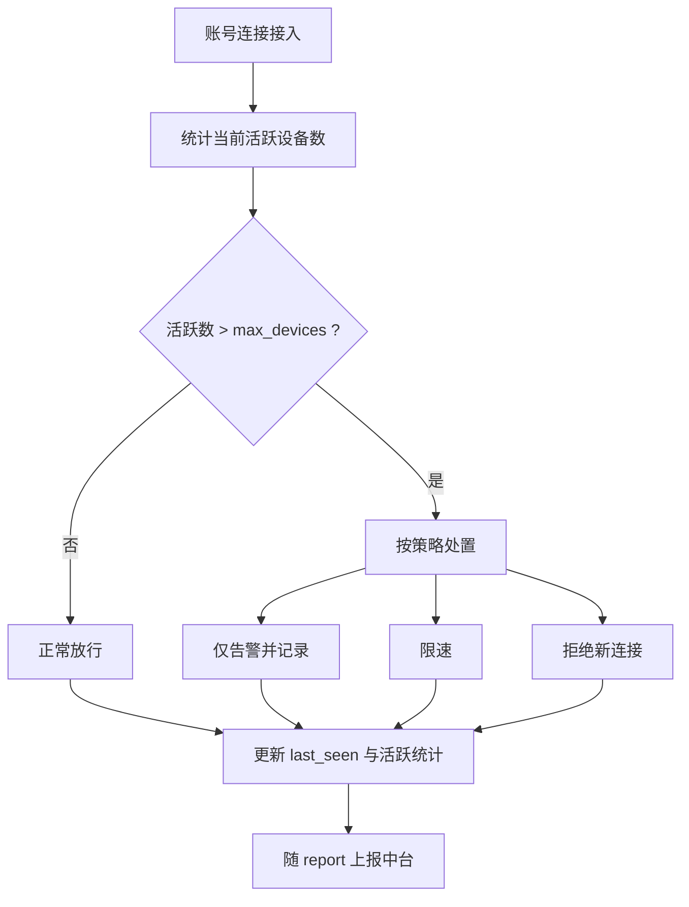
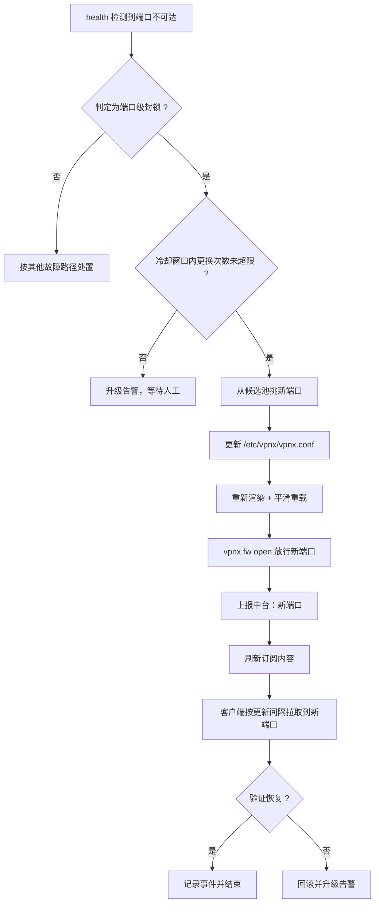
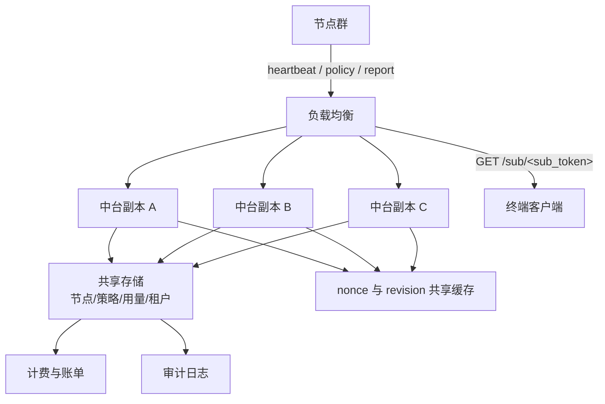
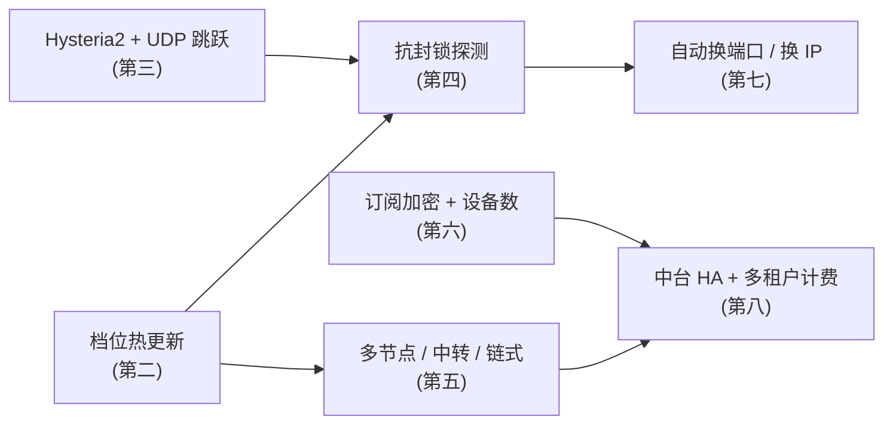

# vpnx 后续阶段路线图

> 本文描述 vpnx 在第一阶段（部署脚本 + 账号逻辑）之后的能力规划。**路线图不代表已实现能力**；本文中出现的新概念、新字段与新命令均属于**规划**，落地前不作为契约使用。
>
> 已实现契约见 [`ARCHITECTURE.md`](./ARCHITECTURE.md)；子命令细节**以 `vpnx <cmd> --help` 为准**。

---

## 0. 阶段总览

| 阶段 | 主题 | 状态 | 核心目标 |
| --- | --- | --- | --- |
| 一 | 部署脚本 + 账号逻辑 | ✅ 已实现 | 单机零依赖部署、账号与配额、中台纳管 |
| 二 | 加密与传输档位持续热更新 | ⏳ 规划 | 不重装、不停服地换档位/换 SNI |
| 三 | Hysteria2 + UDP 端口跳跃 | ⏳ 规划 | 补充 UDP/QUIC 通道，抗 UDP QoS |
| 四 | 抗封锁主动探测与流量整形 | ⏳ 规划 | 降低被动识别与主动探测命中率 |
| 五 | 多节点负载 / 中转 / 链式 | ⏳ 规划 | 从单机走向节点网络 |
| 六 | 订阅加密与设备数限制 | ⏳ 规划 | 订阅侧防泄漏与真实设备治理 |
| 七 | 自动换端口与自动换 IP | ⏳ 规划 | 封锁自愈，减少人工介入 |
| 八 | 中台高可用与多租户计费 | ⏳ 规划 | 中台可规模化运营 |

---

## 1. 第二阶段：加密与传输档位持续热更新

### 1.1 目标

在不重装、不长时间中断服务的前提下，持续更换加密与传输档位：更换 REALITY 的 target/SNI、引入更多传输形态、按客户端能力分发不同档位。

### 1.2 能力项

| # | 能力 | 说明 | 已有基础 |
| --- | --- | --- | --- |
| 1 | **签名档位包** | 档位（`/etc/vpnx/profiles/*.json`）由中台签名下发，节点验签后落地，防篡改 | `vpnx profile add <file>`（已存在）；`policy.signature` 字段（已定义） |
| 2 | **REALITY target/SNI 轮换** | 按计划或按探测结果轮换借用站点，避免长期固定指纹 | `policy.reality.target` / `.sni`（已定义） |
| 3 | **XHTTP 传输** | ✅ **已实现**（`xhttp-reality` 档位：VLESS + XHTTP + REALITY，直连即可用，无需域名/证书/CDN；XHTTP 与 Vision 互斥，订阅里用独立的 `/clash-xhttp` 链接做安全降级） | `--profiles ...,xhttp`、`vpnx selftest` 的 `xhttp` 分支、中台「XHTTP」订阅链接 |
| 4 | **mKCP 传输** | 弱网/高丢包环境下的可选通道 | 同上 |
| 5 | **gRPC 传输** | 适配部分企业网络与既有客户端 | 同上 |
| 6 | 档位灰度 | 同一节点按账号分配不同档位，先小范围验证再全量 | `users.db` 的 `protocols` 白名单 |
| 7 | 档位回滚 | 档位应用失败自动回滚 | `/etc/vpnx/state/last-good.json` |

### 1.3 档位热更新流程（规划）

### 1.4 验收标准（建议）

| 标准 | 目标 |
| --- | --- |
| 热更新期间连接中断 | 既有连接不被强制断开；新连接立即使用新档位 |
| 验签失败 | 拒绝落地，现网配置零变更 |
| 轮换窗口 | 支持定时（如每周）与事件驱动（探测异常）两种触发 |
| 回滚时间 | 从失败检测到回滚完成在秒级 |

> 规划中的档位字段与命令参数**尚未定稿**，落地时以 `vpnx profile --help` 为准。

---

## 2. 第三阶段：Hysteria2 + UDP 端口跳跃

### 2.1 目标

补充基于 QUIC/UDP 的通道，应对 UDP 侧 QoS 与端口级封锁；通过 UDP 端口跳跃规避单端口 UDP 限速与丢弃。

### 2.2 能力项

| # | 能力 | 说明 |
| --- | --- | --- |
| 1 | Hysteria2 入站 | 以 QUIC 为基础的通道，弱网表现好 |
| 2 | UDP 端口跳跃 | 在服务端放行一段 UDP 端口范围，客户端在范围内跳跃 |
| 3 | 端口范围下发 | 中台通过策略下发允许的 UDP 端口段（沿用 `policy.fw_allow_ports` 思路） |
| 4 | 与 REALITY 并存 | Hysteria2 与现有 reality/ss2022/vmess-ws 档位同时可用 |
| 5 | 客户端矩阵扩展 | 覆盖支持 Hysteria2 的客户端；不支持者自动回落到 reality 档位 |
| 6 | 防火墙适配 | 三路防火墙按范围放行；仍坚持**只写自建规则、绝不清空** |

### 2.3 关键约束

| 约束 | 说明 |
| --- | --- |
| UDP 放行范围 | 必须在 `vpnx fw` 能力内可逆添加与撤销 |
| 与面板共存 | UDP 端口段同样从高位端口池挑选，避开面板占用 |
| 计费口径 | UDP 通道的用量必须并入 `used_up` / `used_down`，保持配额语义一致 |
| 客户端兼容 | 回落逻辑必须保证老客户端仍可只用 reality |

### 2.4 拓扑示意（规划）

---

## 3. 第四阶段：抗封锁主动探测与流量整形

### 3.1 目标

降低节点被主动探测识别的概率，并在流量特征层面减少可观测差异。

### 3.2 能力项

| # | 能力 | 说明 |
| --- | --- | --- |
| 1 | **主动探测防护** | 对非预期握手/探测请求返回与借用站点一致的行为，避免"探测即暴露" |
| 2 | **流量整形** | 对包长/时序做整形，削弱隧道特征 |
| 3 | **健康与探测探测联动** | 由 `vpnx health` 侧感知连通性劣化，自动触发档位或 target 轮换 |
| 4 | 稀释式指纹策略 | 多节点使用不同 target/SNI，避免全网同一指纹 |
| 5 | 探测日志与告警 | 记录异常探测事件并上报中台（沿用 `report` 通道） |
| 6 | 阈值化自愈 | 连续失败达到阈值才动作，避免抖动式轮换 |

### 3.3 自愈闭环（规划）

### 3.4 风险与边界

| 风险 | 应对 |
| --- | --- |
| 过度自愈导致频繁切换 | 设置阈值、最小间隔与冷却窗口 |
| 整形影响吞吐 | 整形为可选档位，默认关闭或轻量 |
| 主动探测防护影响真实客户端 | 先灰度单节点，再全量 |

---

## 4. 第五阶段：多节点负载 / 中转 / 链式

### 4.1 目标

从"单机节点"演进为"节点网络"，支持入口节点 + 落地节点、链路中转与按地域/负载的调度。

### 4.2 能力项

| # | 能力 | 说明 |
| --- | --- | --- |
| 1 | 多节点统一纳管 | 中台统一管理多个 `node_id`（现有接口已按节点划分） |
| 2 | 负载感知调度 | 客户端订阅按节点负载/延迟排序，优先低负载 |
| 3 | **中转（relay）** | 入口节点转发到落地节点，降低直连暴露 |
| 4 | **链式（chain）** | 多跳链路，适配高审查网络 |
| 5 | 订阅聚合 | 一个订阅包含多节点，客户端可自动择优/故障切换 |
| 6 | 节点分组 | 按地区、线路、等级分组下发 |
| 7 | 落地节点健康联动 | 落地不可用时从订阅中摘除，避免用户连上不通 |

### 4.3 拓扑示意（规划）

### 4.4 对现有契约的影响

| 影响面 | 说明 |
| --- | --- |
| 订阅内容 | 由单节点列表扩展为多节点列表；`target` 三种格式需支持多节点 |
| `node_id` | 单节点语义不变，链式关系由中台编排 |
| 用量上报 | 中转场景需明确计费归属（入口计费还是落地计费） |
| 策略下发 | `policy` 可能需要新增链路相关字段（尚未定稿） |

---

## 5. 第六阶段：订阅加密与设备数限制

### 5.1 目标

让订阅 URL 本身可安全分发，并让 `max_devices` 从"声明式字段"变为"可执行约束"。

### 5.2 能力项

| # | 能力 | 说明 |
| --- | --- | --- |
| 1 | **订阅加密** | 订阅内容加密或签名，避免明文订阅被扫描滥用 |
| 2 | 订阅短时令牌 | 令牌可轮换、可失效，降低泄漏影响 |
| 3 | **设备数限制执行** | 从 `users.db` 的 `max_devices` 字段落地为真实约束 |
| 4 | 设备指纹 | 基于连接特征统计活跃设备数（不采集隐私内容） |
| 5 | 超限处置 | 超设备数时告警、限速或拒绝新连接（策略可配） |
| 6 | 订阅侧限流 | 限制单位时间订阅拉取次数，防暴力枚举 |
| 7 | 与配额联动 | 设备数与配额、限速共同构成账号策略 |

### 5.3 设备数限制流程（规划）

### 5.4 现有字段衔接

| 字段 | 现状 | 规划 |
| --- | --- | --- |
| `max_devices` | `users.db` 已有，`0` 表示不限 | 成为可执行约束，超限行为可配 |
| `sub_token` | 已有，用于 `GET /sub/<sub_token>` | 支持轮换与短时有效性 |
| `speed_mbps` | 已有限速语义 | 与设备数策略联动 |
| `quota_bytes` | 已实现配额语义 | 与设备数策略联动 |

---

## 6. 第七阶段：自动化的自动换端口与自动换 IP

### 6.1 目标

在端口或 IP 被封锁时，节点能自动完成更换并同步到中台与订阅，把人工介入降到最低。

### 6.2 能力项

| # | 能力 | 说明 |
| --- | --- | --- |
| 1 | **自动换端口** | 检测到端口级封锁后，从候选池换端口并重载 |
| 2 | **自动换 IP** | 通过云厂商 API 更换弹性 IP／重建实例（依赖厂商能力） |
| 3 | 封锁判定 | 结合本机监听、外部探测与客户端反馈综合判定 |
| 4 | 自动同步 | 换端口/换 IP 后自动上报中台并刷新订阅 |
| 5 | 冷却与限额 | 限制单位时间内的更换次数，避免被云厂商风控 |
| 6 | 人工兜底 | 自动失败时升级告警，保留手工处置路径 |

### 6.3 自动换端口闭环（规划）

### 6.4 对客户端的影响

| 环节 | 说明 |
| --- | --- |
| 订阅刷新 | 客户端按 `Profile-Update-Interval` 自动更新，存在最长一个周期的空档 |
| 端口变化感知 | 依赖订阅正常；可用短更新间隔提升恢复速度 |
| 连接中断 | 换端口/换 IP 必然中断现有连接，属于预期代价 |

---

## 7. 第八阶段：中台高可用与多租户计费

### 7.1 目标

让中台可以支撑规模化运营：多副本、无状态化、可计费、可审计。

### 7.2 能力项

| # | 能力 | 说明 |
| --- | --- | --- |
| 1 | **中台高可用** | 多副本部署，节点心跳/上报可打到任一副本 |
| 2 | 策略一致性 | `revision` 单调递增在集群内保持一致，避免节点来回切换 |
| 3 | nonce 去重共享 | 防重放缓存跨副本共享，否则副本切换时可能漏判重放 |
| 4 | **多租户** | 按租户隔离节点、账号、订阅与用量 |
| 5 | **计费** | 基于 `used_up` / `used_down` 的按量或按套餐计费 |
| 6 | 账单与导出 | 周期性账单生成与导出 |
| 7 | 审计日志 | 策略下发、账号变更、节点操作的可追溯记录 |
| 8 | 容量与限流 | 按租户/节点限流，防止单节点上报打满中台 |

### 7.3 中台高可用拓扑（规划）

### 7.4 对现有契约的兼容要求

| 要求 | 说明 |
| --- | --- |
| 接口路径不变 | `/api/v1/node/*` 与 `/sub/<sub_token>` 保持稳定 |
| 签名不变 | `X-VPNX-*` 四头与签名算法保持兼容 |
| revision 语义不变 | 单调递增 + ack 语义在集群化后必须保持一致 |
| 时间窗不变 | 300 秒时间窗与 nonce 防重放跨副本一致生效 |
| 向后兼容 | 老节点（第一阶段版本）必须能继续接入 |

---

## 8. 优先级与依赖关系

| 阶段 | 依赖 | 建议优先级 |
| --- | --- | --- |
| 二 档位热更新 | 无（已具备 profiles 与渲染管线基础） | 高 |
| 三 Hysteria2 + UDP 跳跃 | 防火墙范围放行能力 | 中高 |
| 四 抗封锁探测与整形 | 二、三 | 中高 |
| 五 多节点 / 中转 / 链式 | 二 | 高 |
| 六 订阅加密与设备数 | 无 | 中 |
| 七 自动换端口 / 换 IP | 四 | 中高 |
| 八 中台 HA 与计费 | 五、六 | 高（与业务规模同步） |

---

## 9. 长期演进原则

| 原则 | 说明 |
| --- | --- |
| **契约先行** | 任何新增接口/字段先进入文档契约，再进入实现 |
| **向后兼容** | 老节点、老客户端必须能继续使用；新能力通过档位与策略灰度 |
| **可回滚** | 所有变更都必须能回到 `last-good` 状态 |
| **零依赖优先** | 新能力尽量不引入额外运行时，保持老机器可用 |
| **面板共存不妥协** | 任何新能力都不得触碰 `/usr/local/amh-*`、`/home/wwwroot`、面板服务与端口，不得 `iptables -F` |
| **可观测** | 新能力必须写入 `/var/log/vpnx/` 并可经 `report` 上报中台 |
| **人工兜底** | 自动化失败时必须告警并保留手工处置路径 |

---

## 10. 相关文档

| 文档 | 内容 |
| --- | --- |
| [`ARCHITECTURE.md`](./ARCHITECTURE.md) | 当前已实现的架构与设计取舍 |
| [`COMPATIBILITY.md`](./COMPATIBILITY.md) | 兼容矩阵、降级策略、建站面板 共存清单 |
| [`OPERATIONS.md`](./OPERATIONS.md) | 部署与运维手册 |
| [`CENTRAL-API.md`](./CENTRAL-API.md) | 中台接口契约与签名 |

> 本文所有规划项在落地前均不属于契约。落地后请同步更新上述文档，并保持文件之间不矛盾。